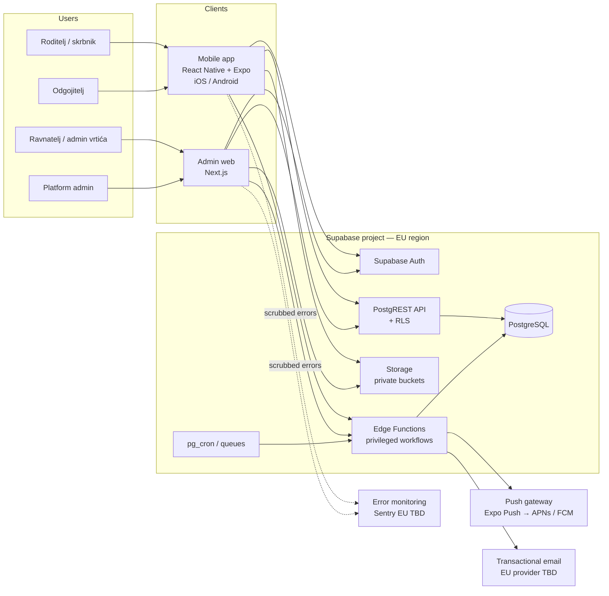

# VrtićOS — Architecture (Phase 0 proposal)

Status: **PROPOSED** — nothing here is approved until the linked ADRs are accepted.
Owner decisions pending are tracked in [phase-status.md](phase-status.md).

## 1. Architectural principles

1. **Modular monolith.** One Postgres database, one backend platform, clear module boundaries in schema and code.
   No microservices without a measured need ([ADR-0002](decisions/0002-modular-monolith-monorepo.md)).
2. **Database is the authorization boundary.** Every tenant-owned table has RLS; clients are untrusted
   ([ADR-0004](decisions/0004-multi-tenancy-rls.md), [ADR-0005](decisions/0005-authorization-model.md)).
3. **EU data residency by default.** Every component that touches personal data runs in the EU or is assessed
   in the transfer assessment ([ADR-0003](decisions/0003-backend-platform-supabase-eu.md)).
4. **Privacy by design.** Data minimization at schema level; retention encoded as data, not as intention.
5. **Boring technology.** Managed services over self-operated infrastructure while the team is small.

## 2. System context



Notes:
- Clients talk to Supabase directly using the user's JWT; RLS enforces access.
- **Edge Functions** handle anything that needs elevated privileges or must be atomic across tables:
  invitations, account linking, signed-URL issuance with consent checks, notification fan-out,
  data-subject-request exports, retention jobs. They re-check authorization explicitly.
- The admin web may use Next.js server components, but **must not hold `service_role`**; it acts with the
  user's session. Whether Vercel processes personal data is a decision in ADR-0006.

## 3. Proposed repository layout

```
apps/
  mobile/            Expo app (parent + educator experiences, role-switched)
  admin/             Next.js admin dashboard
packages/
  design-tokens/     Single source of truth for color/spacing/typography (Style Dictionary or plain TS)
  ui/                Shared primitives where genuinely shareable (tokens > components across RN/web)
  types/             Generated Supabase DB types + domain types
  validation/        Zod schemas shared by clients and Edge Functions
  i18n/              Message catalogs (hr first, it later)
  config/            tsconfig, eslint, prettier presets
supabase/
  migrations/        SQL migrations (only way to change schema)
  functions/         Edge Functions (Deno)
  tests/             pgTAP RLS + authorization tests (incl. negative/cross-tenant)
  seed/              Synthetic seed data only
docs/
```

Evaluation of the proposal: `packages/ui` shared between React Native and web is usually low-yield — the
primitives differ. Recommendation: share **tokens, types, validation, i18n**; keep UI components per app
until duplication is proven.

## 4. Domain model (draft for Phase 1 validation)

```mermaid
erDiagram
  ORGANIZATION ||--o{ LOCATION : has
  ORGANIZATION ||--o{ MEMBERSHIP : grants
  ORGANIZATION ||--o{ SCHOOL_YEAR : runs
  LOCATION ||--o{ GROUP : hosts
  SCHOOL_YEAR ||--o{ GROUP : scopes
  USER_PROFILE ||--o{ MEMBERSHIP : holds
  MEMBERSHIP ||--o{ STAFF_ASSIGNMENT : "staff only"
  GROUP ||--o{ STAFF_ASSIGNMENT : staffed_by
  ORGANIZATION ||--o{ CHILD : enrolls
  CHILD ||--o{ ENROLLMENT : has
  GROUP ||--o{ ENROLLMENT : contains
  CHILD ||--o{ GUARDIANSHIP : has
  USER_PROFILE ||--o{ GUARDIANSHIP : "is guardian"
  CHILD ||--o{ PICKUP_PERSON : "authorized pickup"
  CHILD ||--o{ ATTENDANCE_EVENT : records
  CHILD ||--o{ ABSENCE_REPORT : reports
  CHILD ||--o{ DAILY_REPORT : receives
  GROUP ||--o{ ANNOUNCEMENT : targets
  ORGANIZATION ||--o{ CONVERSATION : contains
  CONVERSATION ||--o{ MESSAGE : has
  CONVERSATION ||--o{ CONVERSATION_PARTICIPANT : has
  ORGANIZATION ||--o{ MEDIA_ASSET : stores
  MEDIA_ASSET ||--o{ MEDIA_CHILD_TAG : depicts
  CHILD ||--o{ MEDIA_CHILD_TAG : tagged_in
  CONSENT_TYPE ||--o{ CONSENT_RECORD : defines
  CHILD ||--o{ CONSENT_RECORD : subject
  USER_PROFILE ||--o{ CONSENT_RECORD : given_by
  ORGANIZATION ||--o{ MENU : publishes
  ORGANIZATION ||--o{ EVENT : schedules
  USER_PROFILE ||--o{ DEVICE_TOKEN : registers
  ORGANIZATION ||--o{ AUDIT_LOG : records
  ORGANIZATION ||--o{ INVITATION : issues
```



Phase 1 alignment (2026-11-10, see `product/consistency-review.md`): the logical model in
`product/domain-model.md` v0.2 is authoritative over this ERD sketch. Notable deltas: `STAFF_ASSIGNMENT` carries
`assignment_type` (regular/substitute, DD-01); `PICKUP_PERSON` is paired with a per-child `PICKUP_AUTHORIZATION`
(DD-03); `ACCESS_RESTRICTION` is a separate entity on guardianship (DD-02); `CONSENT_*` and `MEDIA_*` are **not MVP**
(D-15); added `ANNOUNCEMENT_REVISION`, `NOTICE_ACKNOWLEDGMENT`, `DATA_SUBJECT_REQUEST`, `RETENTION_RULE`.

Key modelling decisions to validate:
- **Time-bounded relationships.** `ENROLLMENT` and `STAFF_ASSIGNMENT` carry `valid_from/valid_to`; access is
  computed from *current* relationships, so moving a child between groups or ending a substitute's
  assignment revokes access without deleting history.
- **Guardianship carries permissions**, not just a link: `can_view`, `receives_messages`,
  `can_report_absence`, `access_restricted` (court-ordered restrictions on a parent are a real case).
- **Pickup persons are not users** by default (grandparent with an ID card) — minimal fields only.
- **Consent is versioned and per purpose** (`CONSENT_TYPE` version + text hash); withdrawal is a new record,
  never an update. Media visibility is computed from consent of *every* tagged child.
- **Audit log** is append-only (no UPDATE/DELETE grants), partitioned by month, retention-bound.

## 5. Roles (draft — full matrix is a Phase 1 deliverable)

| Role | Scope | Can see children | Notes |
|---|---|---|---|
| `platform_admin` | platform | **No** by default; break-glass with reason + audit | Org setup, support |
| `org_admin` | organization | All in org | Kindergarten administration |
| `director` (ravnatelj) | organization | All in org | Reports, announcements |
| `educator` (odgojitelj) | assigned groups (current) | Only enrolled in their current groups | Attendance, reports, messages |
| `staff_other` (e.g. kitchen, health lead) | organization, limited | None | **Not in MVP** (DD-05) |
| `guardian` (roditelj/skrbnik) | own children | Only own children, subject to `access_restricted` | Absences, messages, consent |

## 6. Cross-cutting architecture (to be detailed in Phase 3)

| Concern | Proposal |
|---|---|
| API conventions | PostgREST for CRUD under RLS; RPC (`security invoker` by default) for multi-step ops; Edge Functions for privileged flows. Zod schemas in `packages/validation`. |
| Errors | Typed error codes (`AUTH_*`, `PERM_*`, `VAL_*`, `CONFLICT_*`), Croatian user messages via i18n keys, no PII in error payloads. |
| Notifications | Outbox table → Edge Function fan-out → Expo Push. Payloads carry **no personal data** ("Nova poruka u VrtićOS-u"); app fetches content after auth. Per-user preferences + quiet hours. |
| Media | Private bucket per org prefix, client-side resize + EXIF strip, server-side re-validation of MIME/size, signed URL TTL ≈ 5 min, consent gate on issuance. |
| Search | Postgres full-text (`unaccent` + Croatian config) within RLS. No external search engine. |
| Reporting | SQL views/RPCs scoped by RLS; exports generated server-side, audited, short-lived links. |
| Audit | Triggers + explicit audit RPCs for reads of sensitive data (exports, break-glass). |
| Background jobs | `pg_cron` → Edge Functions: retention purge, notification retries, consent expiry. |
| Offline | Educator attendance tolerant to flaky network (local queue + idempotency keys). Full offline sync is **not** MVP. |
| Observability | Error monitoring with PII scrubbing; no session replay; no product analytics on child-related screens. |
| Environments | `local` (Supabase CLI) / `staging` / `production` — separate Supabase projects, separate keys. |

## 7. What is deliberately NOT in the architecture
Microservices, Kubernetes, GraphQL layer, separate search cluster, event bus, multi-region, per-tenant
databases, AI features on child data. Each can be revisited with evidence.
