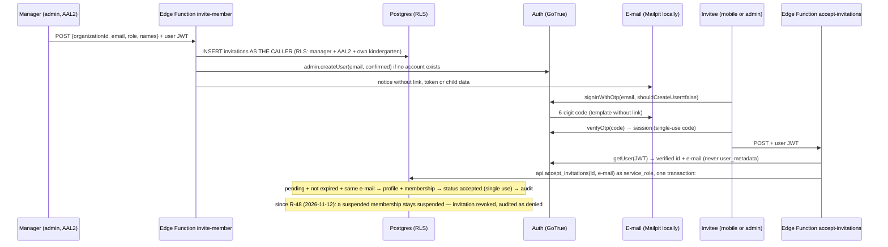

# D1 — identity, invitations, MFA, staff assignments, kindergarten structure

- Version: 0.2 · Date: 2026-11-11 · Status: **implemented; D1-E device check and D1-G owner action open** (see §4)
- Scope approved by the owner (D-25). Builds on D0 (ADR-0009, ADR-0014, ADR-0015, ADR-0016) without changing them.
- Related: FS-01, FS-02, FS-03, FS-09 · SR-AUTHN-01…07, SR-AUTHZ-03/06/07, SR-EF-01…03, SR-AUD-01/02 · AC-01-x, AC-02-x, AC-03-x

## 1. Findings that shaped the design (verified locally, 2026-11-11)
| Probe | Result | Consequence |
|---|---|---|
| `auth.admin.inviteUserByEmail` | creates an *unconfirmed, invited* user and e-mails a **link with a token** | violates SR-AUTHN-01 (no self-authenticating links) → not used |
| `signInWithOtp` for an invited-but-unconfirmed user with signup disabled | `Signups not allowed for this instance` | invited users could not log in with a code → users are created with `admin.createUser` instead |
| `signInWithOtp` for an unknown e-mail | distinct `422 Signups not allowed for otp` | GoTrue-level account enumeration (T-AUTH-02) → UI always shows the same message; residual risk R-42 |
| Official docs (Supabase MCP `search_docs`) | OTP uses the *magic link* template with `{{ .Token }}`; templates via `content_path`; `aal` claim in RLS; Next.js proxy refreshes sessions with `getClaims` | applied as-is |
| Supabase CLI | sends telemetry to PostHog by default | disabled (`SUPABASE_TELEMETRY_DISABLED=1`, `DO_NOT_TRACK=1`) in `scripts/supabase.mjs` |

## 2. Invitation and sign-in flow

## 3. Work packages and acceptance criteria
| ID | Package | Acceptance criteria |
|---|---|---|
| D1-A | Migrations: `staff_assignments`, `invitations`, helper/policy extensions, `api.accept_invitations` | applies from zero; RLS on all; pgTAP NEG for cross-tenant, AAL1, self-escalation, educator scope by date (substitute ends), revocation, single-use + expiry of invitations, audit append-only; catalog checks still green |
| D1-B | Edge Functions `invite-member`, `accept-invitations` | caller authorization enforced by RLS (function inserts as the caller); service key only server-side; no link/token in e-mail; integration tests incl. negative (non-manager, AAL1, other kindergarten, reuse, expired, revoked, wrong e-mail) |
| D1-C | Auth configuration | code-only Croatian e-mail templates; OTP 10 min; TOTP MFA; signup off; local e-mail rate limit documented |
| D1-D | Admin app | OTP sign-in, MFA enrol/verify, sign-out, session refresh via `getClaims`; managers without AAL2 cannot reach data routes; screens: facilities, academic years, groups, staff + invitations + assignments; consistent with prototype; e2e smoke |
| D1-E | Mobile app | OTP sign-in, invitation acceptance, educator "Moje skupine" (today's assignments only), guardian state, sign-out wipes session; secure storage with chunking; bundles build |
| D1-F | Seed + CI | synthetic assignments (incl. substitute) and invitations; integration tests run in CI against the local stack |
| D1-G | GitHub | branch protection for `main` if the session has permission; otherwise documented owner action |

## 4. Results (2026-11-11)

| ID | Result | Evidence |
|---|---|---|
| D1-A | ✅ 3 migrations: `staff_assignments`, `invitations` + `api.accept_invitations`, membership guard (only `org_admin` changes `org_admin` memberships) | pgTAP **105/105** (D0 56 → +49), RLS spike 14/14, catalog checks green |
| D1-B | ✅ `invite-member`, `accept-invitations` | integration **20/20** against the local stack (real Mailpit codes, TOTP AAL2, forged/absent JWT, AAL1, other kindergarten, educator, mass assignment, duplicate, revoked, single use, no enumeration in the invite response) |
| D1-C | ✅ code-only Croatian templates, OTP 10 min, single use, TOTP, signup off; local e-mail rate limit 60/h (demo only) | integration tests: code reuse and wrong code rejected, no link in e-mail |
| D1-D | ✅ admin sign-in, MFA enrol/verify, sign-out, AAL2 gate in the data access layer, structure/staff/invitation screens | Playwright e2e **8/8** (also in CI), visual check against the prototype |
| D1-E | ⚠️ implemented; **not run on a simulator/device** (no simulator in this environment) | typecheck, lint, Expo export (iOS + Android), chunked keychain adapter unit tests; RLS behaviour covered by integration tests — risk R-44 |
| D1-F | ✅ seed (6 regular + 1 substitute assignment, pending/expired/revoked invitations), DB types, CI integration + e2e steps | CI run #6 green incl. integration and e2e |
| D1-G | ❌ `main` is **not protected**; GitHub tools in this session cannot change protection | owner action D-27 (settings in `phase-status.md`), risk R-45 |

Unit tests: 99 (tokens 60, validation 16, domain 11, test-fixtures 7, i18n 5).

### Decisions taken during implementation (all recorded)
- ADR-0017 (Proposed): invitation bound to a verified e-mail address, no token in e-mail, acceptance via service-role RPC.
- Only an `org_admin` may invite an `org_admin` or change an `org_admin` membership (stricter than the matrix's "Ogr." — D-26).
- Ending an assignment takes effect tomorrow; immediate revocation = membership suspension (R-46).
- Admin session cookies are httpOnly (no browser Supabase client in admin).
- Guardian invitations are not offered in the admin UI until D2 (they belong to the child record, FR-01-1).

### Environment notes (sandbox only, nothing committed)
- The cloud sandbox intercepts TLS; the Edge Runtime container needed the sandbox CA appended to its system store to fetch
  npm modules. Not needed on developer machines or GitHub Actions (CI proves it).

### Not done in D1 (carried forward)
- Re-sending an invitation notice (FR-01-2), platform-admin organization creation screen (FR-02-1), session/device list (FR-01-8).
- Privacy notice acknowledgement on first sign-in (FR-01-5) — content comes from the kindergarten ⚖️.

## 5. Parent Home UI (after D1, owner-approved frontend task; visual check on a device pending)
- Presentational screen `apps/mobile/src/features/guardian-home/` per `docs/design/parent-home-spec.md`; props only, no data
  access. The real guardian route (`app/home.tsx`) is unchanged and still shows the §8 empty state.
- Development-only preview `app/dev/parent-home.tsx` with synthetic fixtures behind `__DEV__`; verified that the production
  export contains neither the preview module nor fixture data, and that a development export does.
- Absence actions ("Prijavi izostanak", "Pregledaj izostanak") stay disabled until their destination screens exist (D2+).
- **Visual check on an iOS simulator / Android emulator has NOT been done** (no simulator in the cloud environment; R-44).
  Layout at 320–768 px, large text (130–200 %), VoiceOver/TalkBack and touch targets are reasoned from the code and the
  unit-tested layout rules, not observed.
- Component render tests need an approved test library (`@testing-library/react-native` + `jest-expo`); until then the
  view-model rules are covered by Vitest.
