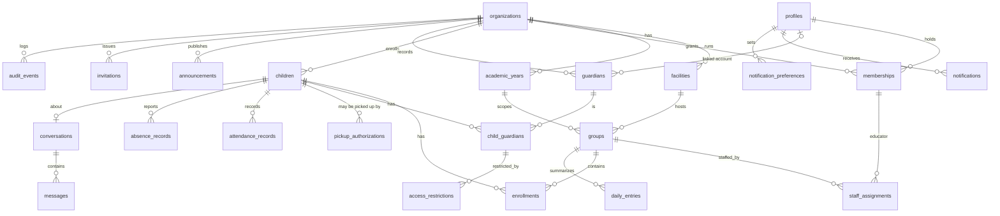

# Database schema — VrtićOS (logical + physical)

- Version: 0.1 · Date: 2026-11-10 · Phase: 3 · Postgres 17 (Supabase)
- Status: design for the first migrations (Phase 5–7). Core patterns **validated** on a local Supabase stack —
  see [spikes/rls-spike.sql](spikes/rls-spike.sql) (14/14 checks pass: tenant isolation, educator scope, expired
  substitute, access restriction, revocation, composite FK, exclusion constraint, `recorded_by` spoofing, grants).
- Sources: [../product/domain-model.md](../product/domain-model.md) v0.2 · [../product/roles-and-permissions.md](../product/roles-and-permissions.md) ·
  [../product/functional-specs.md](../product/functional-specs.md) · [../privacy/data-inventory.md](../privacy/data-inventory.md) ·
  [../security/security-requirements.md](../security/security-requirements.md) · ADR-0004, ADR-0005, ADR-0014

## 1. Conventions
| Topic | Rule |
|---|---|
| Keys | `id uuid primary key default gen_random_uuid()`; never expose sequential IDs |
| Tenant column | `organization_id uuid not null` on every tenant-owned table; immutable after insert (guard trigger) |
| Tenant-safe references | every tenant table has `unique (organization_id, id)`; references between tenant tables are **composite FKs** `(organization_id, x_id) → parent(organization_id, id)` — a row can never point into another kindergarten (validated in spike) |
| Time-bounded relations | `valid_during daterange` (half-open `[from, to)`, `to` null = open); "today" = `private.org_today(org)` in the org's time zone; overlaps blocked with `EXCLUDE USING gist` (`btree_gist`) |
| Timestamps | `timestamptz` UTC; local calendar day stored explicitly where business logic needs it (`local_date`) |
| Status instead of delete | operational rows are archived/ended, not deleted; deletion only by retention jobs (Phase 12, FS-15) |
| Delete rules | `ON DELETE RESTRICT` by default; `CASCADE` only for rows that are purely owned by a parent and carry no evidentiary value (noted per table) |
| Text limits | `check (char_length(x) <= n)` mirrors Zod limits |
| Enums | Postgres enums for stable sets (`org_role`, `attendance_kind`); `text + check` where values are expected to change |
| Schemas | `public` = tables exposed via PostgREST (all with RLS); `api` = exposed `SECURITY INVOKER` RPCs; `private` = helpers, trigger functions, `platform_admins` — **not exposed**, no `EXECUTE` for `anon`/`PUBLIC` |
| Sensitivity | R1–R5 per [data-inventory](../privacy/data-inventory.md) §1 |

## 2. Domain model → physical tables

| Domain entity (domain-model v0.2) | Table | Note |
|---|---|---|
| organization (+ organization_settings) | `organizations` | settings are columns (quiet hours, absence cut-off, notice version) — no separate table |
| location | `facilities` | renamed to match the requested schema; UI term remains "objekt" |
| school_year | `academic_years` | |
| group | `groups` | |
| user_profile | `profiles` | 1:1 with `auth.users` |
| membership (+ notice_acknowledgment) | `memberships` | acknowledgment = columns on membership (per org notice) |
| guardianship | `guardians` + `child_guardians` | **DD-09:** `guardians` is the per-kindergarten person record (exists before the account); `child_guardians` is the relationship with flags |
| access_restriction | `access_restrictions` | kept separate (DD-02, SR-AUTHZ-05) |
| pickup_person + pickup_authorization | `pickup_authorizations` | **DD-10:** one table (name + validity per child); siblings duplicate a name — acceptable for MVP minimality |
| child, enrollment | `children`, `enrollments` | |
| staff_assignment | `staff_assignments` | `assignment_type` regular/substitute (DD-01) |
| attendance_event + attendance_correction | `attendance_records` | corrections/voids are rows referencing the original (`corrects_id`) |
| absence_report | `absence_records` | |
| announcement | `announcements` | `announcement_revision` **deferred**: in the demo a published announcement cannot be edited (only archived) |
| conversation (+ derived participants), message | `conversations`, `messages` | participants derived from relationships (A-07) |
| daily_report | `daily_entries` | one per group per day (A-05) |
| audit_log | `audit_events` | |
| notification_outbox | `notifications` | in-app inbox + push delivery state in one table |
| notification_preference | `notification_preferences` | |
| invitation | `invitations` | |
| — (platform role) | `private.platform_admins` | platform admin is **not** a membership; table not exposed (SR-PRIV-01/02) |
| device_token | `push_tokens` — **deferred** | push delivery not part of the local demo (Expo push service needs an account); in-app notifications only |
| activity_tag | `daily_entries.activity_tags text[]` | org-defined list later |
| menu, event | — **deferred** | Should modules (FS-12, FS-13) after the demo core |
| data_subject_request, retention_rule | — **deferred to Phase 12** | Must before production, not for the demo |
| consent_type, consent_record, media_asset, media_child_link | — **deferred to Phase 11** | photos and consent are out of the MVP and the demo (D-15, ADR-0011) |
| conversation_participant | — (derived) | computed by `private.can_access_conversation()` from relationships, not stored (A-07) |
| guardianship_permission | — (replaced) | flags on `child_guardians` (DD-02) |

## 3. Entity relationship diagram (physical, MVP demo)



## 4. RLS helper functions (`private` schema)
All: `language sql stable security definer set search_path = ''`, `revoke execute … from public, anon`,
`grant execute … to authenticated`. Called from policies as `(select private.fn(...))` or `x in (select private.fn())`
so Postgres evaluates them once per statement.

| Function | Returns | Logic |
|---|---|---|
| `org_today(org)` | date | `now()` in `organizations.timezone` |
| `is_platform_admin()` | bool | `auth.uid()` in `private.platform_admins` **and** `aal = aal2` |
| `is_aal2()` | bool | `(auth.jwt() ->> 'aal') = 'aal2'` |
| `has_org_role(org, roles[])` | bool | active membership (`status='active'`, `valid_during @> org_today`) with role in `roles` |
| `is_org_manager(org)` | bool | `has_org_role(org, {org_admin,director}) and is_aal2()` — A-03: both roles share permissions in MVP |
| `member_org_ids()` | setof uuid | orgs with any active membership |
| `educator_group_ids()` | setof uuid | groups with a staff assignment valid today for an active educator membership |
| `educator_child_ids()` | setof uuid | children with an enrollment valid today in `educator_group_ids()` |
| `guardian_child_ids(flag)` | setof uuid | children with an active `child_guardians` row (valid today, flag true) for a guardian record linked to `auth.uid()` with an active guardian membership, **and no active access restriction** |
| `guardian_group_ids()` | setof uuid | groups in which `guardian_child_ids('can_view')` are enrolled today |
| `visible_profile_ids()` | setof uuid | profiles the caller may see by name (see `profiles`) |
| `can_access_conversation(conversation_id)` | bool | guardian with `receives_messages` for the child, or educator of the child's group today |

**Never used in policies:** `auth.jwt() -> 'user_metadata'` / `raw_user_meta_data` (user-editable, SR-AUTHZ-08).
Role, org and relationship data always come from tables.

## 5. Tables
Notation: **PK** primary key · **FK** foreign keys (→ target, delete rule) · **UQ** unique · **IX** indexes ·
**RLS** policies (S=select, I=insert, U=update, D=delete) · **Grants** client privileges · **Del** deletion rule ·
**Sens.** sensitivity. "Manager" = `private.is_org_manager(organization_id)` (org_admin/director + AAL2).

### 5.1 `organizations` (tenant root)
Columns: `id`, `name` (≤120), `slug` (UQ), `timezone` (default `Europe/Zagreb`), `locale` (default `hr`),
`absence_cutoff_local time null`, `quiet_hours_start time`, `quiet_hours_end time`, `privacy_notice_version text null`,
`status` (`active|suspended`), `invitation_limit_per_hour smallint` (default 50, 1–1000; R-50, operator setting — no client
grant), `created_at`.
- **PK** `id` · **IX** `slug`
- **RLS** S: `id in member_org_ids()` or `is_platform_admin()` · I: none from clients (platform admin creates via Edge Function `create-organization`) · U: manager (guard trigger: only `name`, settings columns; `status` only platform admin) · D: none
- **Grants** `select, update` to authenticated · **Del** never deleted by clients · **Sens.** R1

### 5.2 `facilities`
`id`, `organization_id`, `name` (≤120), `address` (≤200, of the building), `archived_at`.
- **FK** `organization_id → organizations` RESTRICT · **UQ** `(organization_id, id)`; `(organization_id, lower(name)) where archived_at is null`
- **IX** `(organization_id)`
- **RLS** S: `organization_id in member_org_ids()` · I/U: manager · D: none (archive)
- **Del** archive · **Sens.** R1

### 5.3 `academic_years`
`id`, `organization_id`, `name`, `starts_on`, `ends_on`, `status` (`planned|active|closed`).
- **Check** `starts_on < ends_on` · **UQ** `(organization_id, id)`; partial unique `(organization_id) where status='active'` (AC-02-3)
- **RLS** S: members · I/U: manager · D: none · **Sens.** R1

### 5.4 `groups`
`id`, `organization_id`, `facility_id`, `academic_year_id`, `name` (≤80), `capacity int null`, `archived_at`.
- **FK** `(organization_id, facility_id) → facilities`, `(organization_id, academic_year_id) → academic_years` RESTRICT
- **UQ** `(organization_id, id)`; `(organization_id, academic_year_id, lower(name))`
- **IX** `(organization_id, academic_year_id)`, `(facility_id)`
- **RLS** S: manager, `id in educator_group_ids()`, `id in guardian_group_ids()` · I/U: manager · D: none
- **Sens.** R1 (a group name + child link is R3; the group alone is not)

### 5.5 `profiles` (global, not tenant-owned)
`id` (= `auth.users.id`), `first_name`, `last_name`, `display_name`, `locale`, `created_at`. **No email copy** (email stays in `auth.users`).
- **FK** `id → auth.users(id)` RESTRICT (account deletion goes through the DSR procedure, FS-15)
- **RLS** S: `id = auth.uid()` or `id in visible_profile_ids()` · U: own row only; guard trigger allows `first_name, last_name, display_name, locale` · I: none (created by trigger on `auth.users` insert from **invitation data**, never from `user_metadata`) · D: none
- **Visibility rule** (`visible_profile_ids`): managers see members of their orgs; educators see guardians of children in their groups today and staff of their org; guardians see staff with an assignment on their children's groups today (not other parents — FR-04-9)
- **Sens.** R2

### 5.6 `memberships`
`id`, `organization_id`, `profile_id`, `role org_role` (`org_admin|director|educator|guardian`), `status` (`active|suspended|ended`),
`valid_during daterange`, `notice_ack_version text null`, `notice_ack_at timestamptz null`, `created_by`, `created_at`.
- **FK** `organization_id` RESTRICT, `profile_id → profiles` RESTRICT · **UQ** `(organization_id, profile_id, role)`, `(organization_id, id)`
- **IX** `(profile_id, status)`, `(organization_id, role)`
- **RLS** S: own rows, manager · I: none (Edge Function on invitation acceptance) · U: manager for others' rows (`status`, `valid_during`); self only `notice_ack_*` — enforced by guard trigger `private.guard_memberships()` (a user can never change own `role/status`, SR-AUTHZ-07) · D: none
- **Sens.** R2

### 5.7 `children`
`id`, `organization_id`, `first_name` (≤60), `last_name` (≤60), `internal_ref` (≤40, null), `status` (`active|withdrawn`), `withdrawn_on date null`, `created_by`, `created_at`.
**Not present (D-9, Q-P03):** date of birth, OIB, address, photo, health fields.
- **UQ** `(organization_id, id)`; `(organization_id, internal_ref) where internal_ref is not null`
- **IX** `(organization_id, last_name, first_name)`
- **RLS** S: manager, `id in educator_child_ids()`, `id in guardian_child_ids('can_view')` · I/U: manager · D: none
- **Del** RESTRICT; anonymization via retention job (Phase 12) · **Sens.** R3

### 5.8 `guardians`
`id`, `organization_id`, `profile_id null`, `first_name`, `last_name`, `status` (`active|ended`), `created_by`, `created_at`.
**No email or phone** — the address used for invitations lives only in `invitations` (and in `auth.users` after acceptance); educators therefore never see contact data (data minimization).
- **FK** `profile_id → profiles` RESTRICT · **UQ** `(organization_id, id)`; `(organization_id, profile_id) where profile_id is not null`
- **RLS** S: manager; own record (`profile_id = auth.uid()`); educators for guardians linked to `educator_child_ids()` (handover list, FR-05-3) · I/U: manager · D: none
- **Sens.** R2

### 5.9 `child_guardians`
`id`, `organization_id`, `child_id`, `guardian_id`, `can_view`, `can_report_absence`, `receives_messages` (bool), `valid_during`, `created_by`, `created_at`.
- **FK** `(organization_id, child_id) → children`, `(organization_id, guardian_id) → guardians` RESTRICT
- **UQ** `(organization_id, id)`; **EXCLUDE** `(child_id with =, guardian_id with =, valid_during with &&)`
- **IX** `(guardian_id)`, `(child_id)`
- **RLS** S: manager; guardian's own rows; educators for `educator_child_ids()` (flags only, needed for handover) · I/U: manager · D: none (end via `valid_during`)
- **Sens.** R3

### 5.10 `access_restrictions`
`id`, `organization_id`, `child_guardian_id`, `scope` (`full`; more scopes later), `valid_during`, `reference` (≤100, internal case reference — **no reason, no court text**), `created_by`, `created_at`.
- **FK** `(organization_id, child_guardian_id) → child_guardians` RESTRICT · **IX** `(child_guardian_id)`
- **RLS** S/I/U: **manager only** · D: none · Audit: every change
- **Sens.** **R4**

### 5.11 `pickup_authorizations`
`id`, `organization_id`, `child_id`, `first_name`, `last_name`, `valid_during`, `created_by`, `created_at`. Phone/relationship: Q-T13 (not stored).
- **FK** `(organization_id, child_id) → children` RESTRICT · **IX** `(child_id)`
- **RLS** S: manager, educators (`educator_child_ids()`), guardians (`guardian_child_ids('can_view')`) · I/U: manager (SR-AUTHZ-09) · D: none
- **Sens.** R3

### 5.12 `enrollments`
`id`, `organization_id`, `child_id`, `group_id`, `valid_during`, `created_by`, `created_at`.
- **FK** composite to `children`, `groups` RESTRICT · **EXCLUDE** `(child_id with =, valid_during with &&)` (one active group per child; validated)
- **IX** `(group_id)`, `(child_id)`
- **RLS** S: manager, educators (`group_id in educator_group_ids()`), guardians (`child_id in guardian_child_ids('can_view')`) · I/U: manager; transfer via `api.transfer_child()` (invoker, one transaction) · D: none
- **Sens.** R3

### 5.13 `staff_assignments` — implemented in D1 (`20261111100000_staff_assignments.sql`)
`id`, `organization_id`, `membership_id`, `group_id`, `assignment_type` (`regular|substitute`), `valid_during daterange`, `approved_by`, `created_by`, `created_at`, `updated_at`.
- **FK** `(organization_id, membership_id) → memberships`, `(organization_id, group_id) → groups` RESTRICT
- **Check** not empty; substitute ⇒ finite end (FR-03-3). **Exclusion** no overlapping ranges for the same membership + group.
- **Guard trigger** caller must be a manager (AAL2) before anything else; membership role must be `educator`; `created_by` and
  (for substitutes) `approved_by` = caller; after insert only `valid_during` may change.
- **IX** `(membership_id)`, `(group_id)`
- **RLS** S: manager; own (via `private.own_membership_ids()`) · I/U: manager · D: none (end an assignment by shortening it)
- Educator group access: `private.educator_group_ids()` = active educator membership valid today **and** assignment valid today
  (kindergarten time zone); `groups_select` = manager or that set.
- **Sens.** R2

### 5.14 `attendance_records`
`id`, `organization_id`, `child_id`, `kind attendance_kind` (`check_in|check_out|void`), `occurred_at`, `local_date` (set by trigger from org tz), `recorded_by` (default `auth.uid()`), `recorded_at` (default `now()`), `source` (`app|admin|offline_sync`), `handover_child_guardian_id null`, `handover_pickup_id null`, `corrects_id null`, `correction_reason` (`entry_error|forgot|other`, null), `idempotency_key uuid`.
- **FK** composite to `children`; `(organization_id, handover_child_guardian_id) → child_guardians`; `(organization_id, handover_pickup_id) → pickup_authorizations`; `(organization_id, corrects_id) → attendance_records`
- **Check** at most one handover reference; `void` requires `corrects_id`; correction after undo window requires `correction_reason`
- **UQ** `(organization_id, idempotency_key)` (SR-API-08) · **IX** `(organization_id, local_date)`, `(child_id, local_date)`
- **RLS** S: manager, educators (`child_id in educator_child_ids()`), guardians (`can_view`) · I: educator for `educator_child_ids()` with `recorded_by = auth.uid()` and `local_date = org_today`; manager (any child of org) · U/D: **no grant** (immutable; validated)
- **Guard trigger:** void within 10 s by the same recorder without reason; later corrections only by manager with reason (FR-05-5, SR-AUTHZ-12)
- **Sens.** R3

### 5.15 `absence_records`
`id`, `organization_id`, `child_id`, `starts_on`, `ends_on`, `reported_by`, `source` (`guardian|staff_on_behalf`), `status` (`active|cancelled`), `is_late`, `cancelled_by`, `cancelled_at`, `created_at`. **No reason field** (FR-06-2, Q-P16).
- **Check** `starts_on <= ends_on`, `ends_on - starts_on <= 30`
- **IX** `(organization_id, starts_on)`, `(child_id, starts_on)`
- **RLS** S: manager, educators, guardians (`can_view`) · I: guardian (`child_id in guardian_child_ids('can_report_absence')`, `source='guardian'`, `reported_by=auth.uid()`), manager (`staff_on_behalf`) · U: cancel only — guard trigger permits `status→cancelled` for reporter or manager, future days only · D: none
- **Sens.** R3

### 5.16 `announcements`
`id`, `organization_id`, `author_id`, `title` (≤120), `body` (≤4000), `audience_scope` (`organization|facility|group`), `audience_ids uuid[]` (facility/group IDs; validated by trigger against the same org), `audience_roles text[]` (`guardians`, `staff`), `status` (`draft|published|archived`), `published_at`, `created_at`.
- **IX** `(organization_id, status, published_at desc)`; GIN on `audience_ids`
- **RLS** S: manager; author; recipients — `status='published'` and audience matches current relationships (guardian: `guardian_group_ids()` / their facilities / org; staff: assignments) · I/U: manager (educator: Otvoreno → denied, SR-AUTHZ-10) · D: none (archive)
- Published rows are immutable except `status→archived` (demo: no revisions)
- **Sens.** R2

### 5.17 `conversations`
`id`, `organization_id`, `child_id`, `created_at`.
- **FK** composite to `children` · **UQ** `(organization_id, child_id)` — one conversation per child (A-07)
- **RLS** S: `can_access_conversation(id)` · I: guardian with `receives_messages` or educator of the child (`api.open_conversation(child_id)` is idempotent) · U/D: none
- **Managers: no access to content** until Q-T16 (SR-AUTHZ-11)
- **Sens.** R3

### 5.18 `messages`
`id`, `organization_id`, `conversation_id`, `sender_id`, `body` (≤2000, null when withdrawn), `created_at`, `withdrawn_at`.
- **FK** `(organization_id, conversation_id) → conversations` RESTRICT · **IX** `(conversation_id, created_at desc)`
- **RLS** S: `can_access_conversation(conversation_id)` · I: same, `sender_id = auth.uid()` · U: guard trigger — sender only, within 5 min, only `withdrawn_at` (sets `body = null`) · D: none
- **Sens.** **R4**

### 5.19 `daily_entries`
`id`, `organization_id`, `group_id`, `entry_date`, `body` (≤1000), `activity_tags text[]`, `status` (`draft|published`), `author_id`, `published_at`, `edited_at`.
- **FK** composite to `groups` · **UQ** `(organization_id, group_id, entry_date)`
- **RLS** S: manager; educators of the group; guardians — `published` and a child of theirs was enrolled in the group on `entry_date` · I/U: educator with assignment on the group today (`entry_date = org_today`; edits same day only) · D: none
- **Sens.** R3

### 5.20 `audit_events` — implemented as `audit.audit_events` (R-51, `20261112084900_audit_schema_and_actor.sql`)
`id bigint generated always as identity`, `organization_id null` (null = platform-level), `occurred_at`, `actor_id`, `actor_role`, `action` (e.g. `child_guardian.updated`), `target_table`, `target_id`, `outcome` (`success|denied|error`), `correlation_id`, `details jsonb` (allow-listed keys only: changed column **names**, never values).
- **Implemented (2026-11-12):** table in the non-exposed schema `audit`; `public.audit_events` is a read-only
  `security_invoker` view (same columns), so reads go through the table's RLS. Trigger `audit_events_fill` sets
  `actor_role` (highest active role in that kindergarten, `platform_admin`, `none`, or `system` without an actor),
  `occurred_at` and `correlation_id` (`app.correlation_id` or a validated `x-correlation-id` header,
  `^[A-Za-z0-9._-]{8,64}$`). A service-role JWT may attribute a row with `x-actor-id` (`details.via = 'service'`).
  Grants: authenticated `select`; service_role `select, insert`; nobody `update/delete/truncate`; trigger
  `audit_events_no_update` refuses UPDATE for every role. Denied attempts outside a transaction:
  `api.record_audit_event` (service_role only, allow-listed shape).
- **No FK** to targets (must outlive them) · **IX** `(organization_id, occurred_at desc)`, `(target_table, target_id)`; monthly partitioning when volume requires
- **RLS** S: manager of the org; platform admin only for rows with `action like 'organization.%'` · I/U/D: **no grants** — written only by `private.write_audit()` from triggers/Edge Functions (SR-AUD-02)
- **Sens.** R3

### 5.21 `notifications`
`id`, `organization_id`, `recipient_id`, `type` (`announcement.published|absence.reported|message.received|daily_entry.published`), `resource_type`, `resource_id`, `created_at`, `read_at`, `push_status` (`not_applicable|pending|sent|failed`), `push_attempts`.
**No title or body is stored** — the client fetches the resource under its own RLS (SR-PUSH-01).
- **FK** `recipient_id → profiles` RESTRICT · **IX** `(recipient_id, read_at, created_at desc)`
- **RLS** S: `recipient_id = auth.uid()` · U: own rows, column grant `update (read_at)` only · I: none (definer triggers on source tables) · D: none
- **Sens.** R2

### 5.22 `notification_preferences`
PK `(profile_id, type)`, `push_enabled bool`.
- **FK** `profile_id → profiles` **CASCADE** (pure preference, no evidentiary value)
- **RLS** S/I/U: `profile_id = auth.uid()` · **Sens.** R2

### 5.23 `invitations` — implemented in D1 (`20261111100100_invitations.sql`, ADR-0017; R-48 fix `20261112075500_suspension_blocks_invitations.sql`)
`id`, `organization_id`, `email citext`, `role org_role`, `first_name`, `last_name`, `status` (`pending|accepted|revoked`),
`expires_at` (default +7 days, max 30), `created_by`, `accepted_by/at`, `revoked_by/at`, `created_at`, `updated_at`.
**Deviation from the Phase 3 sketch:** no `token_hash` (no secret in e-mail — possession is proven by the sign-in code),
`expired` is derived from `expires_at`, `guardian_id` follows in D2.
- **UQ** partial `(organization_id, email, role) where status = 'pending'`; **IX** `lower(email::text) where pending`
- **Guard trigger** client insert: `created_by` = caller, `status` = pending, `org_admin` only by an `org_admin`;
  client update: only pending → revoked (`revoked_by/at` set by the database). Since R-48 the insert path first requires
  `is_org_manager` (callers without rights always get `PERMISSION_DENIED`), then refuses an invitation whose e-mail holds a
  **suspended** membership with the same role in that kindergarten (`MEMBERSHIP_SUSPENDED`; lookup
  `private.has_suspended_membership`, answers only for a kindergarten the caller manages)
- **Suspension** (`memberships_suspension_revokes_invitations`, AFTER UPDATE OF status → `suspended`): revokes pending
  invitations for the same kindergarten, role and e-mail
- **Acceptance** (`api.accept_invitations`): a suspended membership is never re-activated — the invitation is revoked and
  audited `invitation.accept_refused` (`denied`); an ended or expired membership is re-activated from today; an active one
  is left unchanged
- **RLS** S/I/U: manager (AAL2) · D: none · acceptance only via `api.accept_invitations` (service_role)
- **Limit (R-50, `20261112085000_invitation_quota.sql`):** after authorization the guard counts every invitation created in
  the kindergarten during the last hour (per-kindergarten advisory lock); at `invitation_limit_per_hour` the insert is
  skipped and `invitation.limit_reached` (`denied`) is audited in the same transaction. Applies to clients and the
  service key
- **Sens.** R2

### 5.25 `privacy_notices` — implemented (`20261112093000_privacy_notices.sql`, FR-01-5)
`id`, `organization_id`, `version` (1–40), `title` (1–120), `body` (1–20,000), `is_demo bool`, `created_at`. UQ
`(organization_id, version)`. `organizations (id, privacy_notice_version)` → FK to `(organization_id, version)`: only an
existing own version can be published. Versions are immutable (trigger `PRIVACY_NOTICE_IMMUTABLE`); the published one
cannot be deleted (FK).
- **RLS** S: active members of that kindergarten (`member_org_ids()`) · I/U/D: no client grant (operators / service)
- **Acknowledgement** (`memberships.notice_ack_version/at`): only by the person themselves, only the currently published
  version (`NOTICE_VERSION_MISMATCH`), time set by the database; audited as `memberships.update` (column names only).
- **Sens.** R1 (the kindergarten's document; no personal data)

### 5.24 `private.platform_admins`
`profile_id` PK → `profiles`. No grants; read only by `private.is_platform_admin()`. Populated by an operator procedure (SR-OPS-04).

## 6. Grants baseline
```sql
-- applied in the first migration
revoke all on all tables in schema public from anon, authenticated;
revoke execute on all functions in schema public, private from public, anon;
alter default privileges in schema public revoke all on tables from anon, authenticated;
-- then per table: grant only the operations listed in §5 to authenticated; anon gets nothing
```
`anon` has **no** table privileges at all; unauthenticated screens (login) only call Auth endpoints.

## 7. Triggers
| Trigger | Tables | Purpose |
|---|---|---|
| `private.set_tenant_guard` | all tenant tables (BEFORE UPDATE) | reject change of `organization_id` |
| `private.guard_*` | memberships, attendance_records, absence_records, messages, announcements, daily_entries, organizations, profiles | column-level rules RLS cannot express (who may change which column) |
| `private.audit_*` | memberships, staff_assignments, children, enrollments, child_guardians, access_restrictions, pickup_authorizations, attendance_records (corrections/voids), absence_records (staff_on_behalf, cancel), announcements (publish/archive), invitations | append `audit_events` (FR-09-1) |
| `private.fanout_notifications` | announcements (publish), absence_records (insert), messages (insert), daily_entries (publish) | insert content-free `notifications` rows for current recipients |
| `private.set_local_date` | attendance_records | derive `local_date` from org tz |
| `private.on_auth_user_created` | `auth.users` (AFTER INSERT) | create `profiles` row from the accepted invitation, not from `user_metadata` |

## 8. Verification plan (feeds security-test-plan)
- Catalog checks ST-RLS-00 (as in the spike's last check, extended to grants, definer functions, views, buckets).
- Generated permission-matrix tests (ST-RLS-01) — every table × role × operation in §5.
- NEG-01…NEG-15 as pgTAP.
- Performance: seed 10 orgs / 1,000 children / 3,000 accounts; `EXPLAIN ANALYZE` the educator morning list and guardian home queries; target p95 < 50 ms at DB level (NFR-PERF-03 leaves headroom).

## 9. Open points
| Item | Decision needed |
|---|---|
| Overlapping academic years (Q-T12) | Partial unique index assumes one active year |
| Guardians seeing co-guardian names | Currently **no** (minimization); validate |
| Educator visibility of historical attendance of children who left the group | Currently tied to today's enrollment; validate with educators |
| `audit_events` integrity (hash chain) | SR-AUD-03, Phase 5 decision |
| Push tokens table | when push is implemented (needs D-7) |

## 10. Implementation status (D0, 2026-11-11)
Migrations in `supabase/migrations/` (apply from zero with `pnpm db:reset`):

| Migration | Contents |
|---|---|
| `20261111000100_foundation.sql` | extensions (`btree_gist`, `citext`), schemas `api`/`private`, default-privilege lock-down, enums, generic guards |
| `20261111000200_organization_structure.sql` | `organizations`, `facilities`, `academic_years`, `groups`, `profiles`, `memberships`, `private.platform_admins`, `audit_events`, composite FKs, partial unique index (one active year) |
| `20261111000300_authorization.sql` | helpers (`org_today`, `is_aal2`, `is_platform_admin`, `has_org_role`, `is_org_manager`, `member_org_ids`, `managed_org_ids`, `visible_profile_ids`), RLS policies, column-level grants, membership guard trigger, audit trigger |

Deliberate D0 limits (deny by default until the relationship tables exist):
- `groups` are visible to managers only; educator (staff assignments, D1) and guardian (enrollments, D2) policies follow.
- `profiles` are visible to the owner and to managers of their kindergartens only.
- Audit actions from triggers are named `<table>.<insert|update>` with changed **column names** only.

Finding during D0 (fixed): per-schema `ALTER DEFAULT PRIVILEGES … REVOKE` cannot remove PostgreSQL's global
`EXECUTE` default for `PUBLIC`, so a trigger function in `private` was executable by `anon`. Caught by catalog check
ST-RLS-00; fixed by a global default-privilege revoke and an explicit final revoke in the authorization migration.
