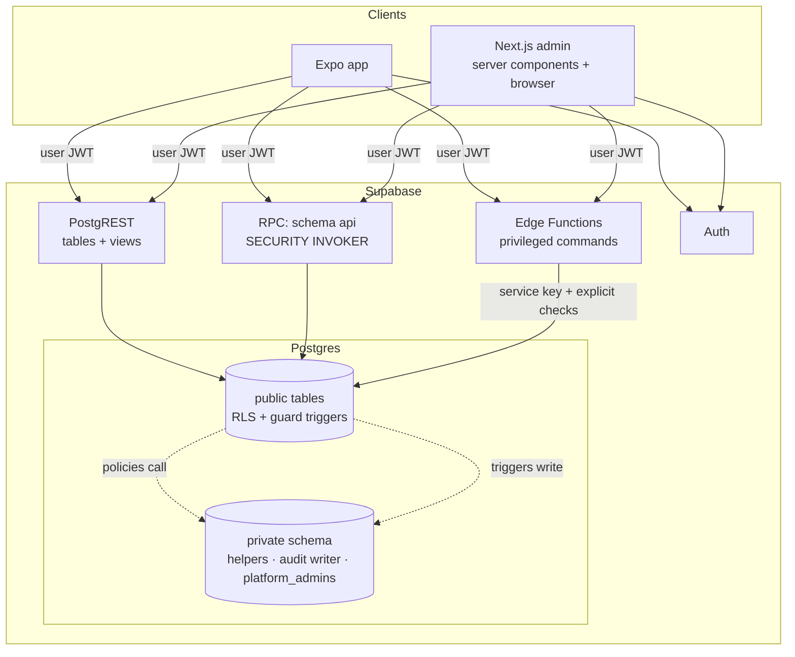

# Technical architecture — VrtićOS

- Version: 0.2 · Date: 2026-11-11 · Phase: 3, **aligned with the code after D1** (implemented vs planned is marked)
- Status: **implementation plan for the demo build**. Platform decisions D-3…D-8 remain *Proposed*; the demo runs
  **only locally** (ADR-0009), so it needs no cloud account, paid service or production data.
- Owner decision 2026-11-10: build a functional demo of the whole app before validation interviews finish.
  MVP stays unconfirmed; assumptions stay labelled (PRD §9).
- Parent docs: [../architecture.md](../architecture.md) (system context) · [database-schema.md](database-schema.md) ·
  [api-conventions.md](api-conventions.md) · [mobile-app.md](mobile-app.md) · [admin-app.md](admin-app.md) ·
  [local-development.md](local-development.md) · [../security/security-requirements.md](../security/security-requirements.md)

## 1. Guiding constraints
1. Modular monolith: one Postgres database, one repo (ADR-0002).
2. The database is the authorization boundary; clients are untrusted (ADR-0004, ADR-0005, ADR-0014).
3. No React DOM component is shared with React Native. Shared code is limited to **tokens, i18n, validation,
   types and pure domain logic**.
4. Everything runs locally with synthetic data; no paid or production service is required to develop or demo (ADR-0009).
5. Security requirements (SR-xx) are implementation inputs, not later hardening.

## 2. Monorepo layout (as implemented after D1)

```
apps/
  mobile/                 Expo (React Native) app — guardian + educator views (mobile-app.md)
  admin/                  Next.js App Router admin (admin-app.md)
packages/
  config/                 shared tsconfig base only (ESLint flat config lives in the root eslint.config.js; no Prettier)
  tokens/                 design tokens authored in TypeScript (src/palette.ts, theme.ts, scale.ts) → TS constants for RN;
                          scripts/build-css.ts → dist/tokens.css for web; scripts/design-sync.ts → DESIGN.md + prototype
  i18n/                   message catalogs (hr; it structure only), date/time helpers in Europe/Zagreb
  validation/             Zod schemas for Edge Function inputs, admin actions and sign-in; error code catalog
  db-types/               generated Supabase types (`pnpm db:types`) — never edited by hand
  domain/                 pure TS: attendance state, local dates, daterange helpers, chunked session storage
  test-fixtures/          synthetic "Alfa/Beta" world → supabase/seed.sql and docs/architecture/demo-accounts.md
tests/
  integration/            Vitest against the local stack (Edge Functions, Mailpit codes, TOTP) + Playwright e2e (admin)
supabase/
  config.toml             local stack config (Auth code-only e-mail templates, Mailpit, TOTP MFA)
  migrations/             SQL migrations — the only way to change schema
  functions/              Edge Functions (Deno): invite-member, accept-invitations, _shared helpers
  templates/              Auth e-mail templates (6-digit code, no link)
  tests/database/         pgTAP: catalog checks, tenant isolation, staff assignments and invitations
  seed.sql                synthetic seed generated from packages/test-fixtures
docs/
```

**Not implemented (planned in Phase 3):** a `packages/supabase-client` with shared client factories does not exist.
Clients are created where they are used: `apps/admin/src/lib/supabase/server.ts`, `apps/admin/src/proxy.ts`,
`apps/mobile/src/lib/supabase.ts` and `supabase/functions/_shared/clients.ts`. Revisit if a fifth place appears.

**Boundary rules (root `eslint.config.js`):** `packages/**` must not import `react`, `react-native` or `react-dom`;
`apps/mobile` must not import `next` or `react-dom`; `apps/admin` must not import `react-native`; string literals
naming the service/secret key are rejected in `apps/`, `packages/` and `scripts/` (SR-SUP-04). There is no rule yet
that stops `packages/*` from importing `apps/*`. `supabase/**` is excluded from ESLint; Edge Functions are checked by Deno instead (`pnpm functions:check`,
`pnpm functions:lint`, one canonical `supabase/functions/deno.json` + `deno.lock`, R-47 closed 2026-11-12).

## 3. Technology choices
Versions are pinned in `pnpm-lock.yaml` (ADR-0016). The column **Status** separates what is installed after D1
from what is still planned.

| Area | Choice | Version | Notes / status |
|---|---|---|---|
| Package manager | pnpm via Corepack, pinned in `packageManager` | 12.18.0 | **Verified in D0** (ADR-0016): isolated layout works with Expo; always via Corepack |
| Build orchestration | Turborepo | 2.11.10 | Local cache only; no remote cache (no Vercel account) |
| Language | TypeScript `strict` + `noUncheckedIndexedAccess` | **6.0.3** (7.0.2 rejected) | ADR-0016: typescript-eslint does not support TS 7; Expo SDK 58 template pins ~6.0.3 |
| Mobile | Expo SDK 58, React Native 0.88, Expo Router | expo 58.0.23, RN 0.88.1, expo-router 58.0.30 | ADR-0006, ADR-0015 |
| Web admin | Next.js App Router | 16.4.6 | ADR-0006 |
| React | 19.x | 19.3.1 | Version dictated by Expo SDK; admin aligns |
| Backend | Supabase (Postgres 17, PostgREST, GoTrue Auth, Storage, Edge Runtime) | CLI 3.1.0; postgres image 17.6.1.054 | Local via Docker (ADR-0009) |
| Supabase client | `@supabase/supabase-js`, `@supabase/ssr` (admin) | 2.119.0, 0.12.7 | |
| Validation | Zod | 4.6.7 | Installed. Shared by admin, mobile and Edge Functions |
| Server state | TanStack Query | — | **Planned, not installed** (ADR-0015). Mobile uses local state + `useEffect` loaders; admin uses Server Components |
| i18n | i18next + react-i18next (mobile); small server-side translator over the same catalog (admin) | 27.1.1, 18.0.1 | Installed |
| Secure storage | expo-secure-store (chunked adapter from `packages/domain`) | 58.0.2 | Installed. SR-SESS-01 |
| Offline queue | expo-sqlite (encrypted payload) | — | **Planned for D3, not installed** (ADR-0012) |
| Lists | @shopify/flash-list | — | **Planned, not installed** |
| Error monitoring | Sentry (`@sentry/react-native`, `@sentry/nextjs`) | — | **Not installed**; only after D-7 |
| Unit tests | Vitest | 5.1.0 | Installed: packages, `apps/mobile` (pure view-model tests), `tests/integration`. No unit tests in `apps/admin` yet |
| Component tests (RN) | `@testing-library/react-native` + `jest-expo` | — | **Not installed; needs owner approval** |
| DB tests | pgTAP (bundled in Supabase Postgres) | — | security-test-plan L1/L2 |
| Integration tests | Vitest against the local stack | 5.1.0 | `tests/integration` (Edge Functions, Mailpit codes, TOTP) |
| E2E | Playwright (admin) | 1.63.0 | Installed in `tests/integration`; Maestro (mobile) planned, needs an emulator |
| CI | GitHub Actions | — | §7 |

## 4. Data access architecture



| Path | Use for | Security rule |
|---|---|---|
| **PostgREST tables/views** | Reads; simple single-table writes (attendance check-in, absence report, message send, admin CRUD) | RLS on every table; guard triggers for column-level rules; views `security_invoker` (SR-TEN-06) |
| **RPC in `api` schema** | Multi-step transactional commands the caller is already allowed to do step by step (transfer child, publish announcement, cancel absence) | `SECURITY INVOKER` only (SR-API-02); input validated in SQL + Zod |
| **Edge Functions** | Operations needing Auth admin or external I/O. Implemented: `invite-member` (inserts the invitation as the caller, then Auth admin + notice e-mail), `accept-invitations` (calls `api.accept_invitations`). Later: push dispatch, DSR export (Phase 12) | User JWT client by default; service key only inside function with explicit authorization and audit (SR-EF-01…03) |
| **Bootstrap RPC** | `api.accept_invitations(user_id, email)` creates the profile and membership from a pending invitation (ADR-0017). Replaces the planned profile-bootstrap trigger | `SECURITY INVOKER`, EXECUTE for `service_role` only |
| **Triggers** | Audit events (`private.audit_row`), guard triggers, `updated_at`; later notification fan-out and derived columns | Live in `private`, fixed `search_path`, no client EXECUTE (SR-API-01) |

Realtime is **off** for the demo (SR-API-05); clients refetch on focus and pull-to-refresh. Revisit for messages.

## 5. Shared packages in practice
- **tokens:** TypeScript source (`palette.ts`, `theme.ts`, `scale.ts`) consumed directly by RN; `build-css.ts` writes
  `dist/tokens.css` for the admin; `design-sync.ts` regenerates the DESIGN.md frontmatter and the prototype CSS (CI diffs both).
- **i18n:** keys namespaced by module (`attendance.*`, `auth.*`, `admin.*`, `mobile.*`, `guardianHome.*`); `hr` complete,
  `it` is `Partial` and empty. **No CI key-completeness check exists yet** (planned).
- **validation:** `packages/validation/src/<module>.ts` exports `zXxxInput` schemas and inferred types. Edge Functions
  import the same TypeScript source by **relative path** (`../../../packages/validation/src/invitation.ts`); `zod` and
  `@supabase/supabase-js` resolve through `deno.json` import maps (`npm:` specifiers, pinned). The same `deno.json`
  exists in three copies (functions root and each function).
- **domain:** pure functions with unit tests (e.g. `attendanceStatusForDay(events)`, `orgLocalDate(now, tz)`);
  SQL remains the authority for authorization — domain code never decides access.

## 6. Error handling and monitoring
- Error envelope and codes: [api-conventions.md](api-conventions.md) §4.
- Clients map codes to i18n messages; unknown errors show a generic message with a correlation ID.
- Sentry (after D-7 approval): `sendDefaultPii: false`, `beforeSend` scrubber removing request bodies, query
  strings, breadcrumbs of `console`, user identifiers except a random install ID; no session replay, no screenshots
  (SR-LOG-01). A unit test asserts the scrubber removes synthetic child names (ST-LOG-01).
- Local: errors to console only; no third-party transmission.

## 7. CI/CD (GitHub Actions) — as implemented (`.github/workflows/ci.yml`)
Runs on every push and pull request. **No deploy job exists until production decisions (D-3, D-6) are approved.**

| Job (display name) | Steps |
|---|---|
| `quality` (lint · typecheck · unit tests) | frozen install → `pnpm lint` → `pnpm typecheck` → `pnpm test` (Vitest) → seed generator determinism diff → `pnpm design:sync` diff → Deno 2.1.4 `pnpm functions:check` (`--frozen`) → `pnpm functions:lint` |
| `db` (database · migrations · RLS · integration · e2e) | `pnpm db:start` (migrations + seed from zero) → `pnpm db:test` (pgTAP) → `pnpm db:spike` → `pnpm db:types` diff → `pnpm test:integration` → admin build against the local stack → Playwright e2e (admin) |
| `apps` (admin build · mobile bundle) | `next build` → `expo export` (iOS + Android JS bundles) → no secret keys in client bundles |
| `security` (secrets · dependencies) | gitleaks (full history) → `pnpm audit --audit-level high` |

Not implemented from the Phase 3 plan: license check, i18n key check, nightly
e2e (e2e runs in every `db` job instead). Whether jobs block merges depends on branch protection, which is **not set**
on `main` (owner action D-27, risk R-45).

## 8. Environments
| Environment | Exists now | Data | Notes |
|---|---|---|---|
| local / demo | **yes** (ADR-0009) | synthetic seed only | Laptop + phones on the same Wi-Fi for kindergarten demos |
| staging | no | synthetic only | Requires D-3 |
| production | no | real (only after Phase 14 gates) | Requires D-3, D-6, D-7, legal review |

## 9. Requirement coverage (architecture → SR)
Target mapping. Implemented after D1: RLS, composite FKs, exclusion constraints, `private` helpers, invoker RPC, guard
triggers, column grants, AAL2 checks, invitation Edge Functions, secure storage on mobile, CSP + text-only rendering,
audit triggers and the CI jobs in §7. **Planned:** notifications table + push, encrypted offline queue.

| Architecture element | Covers |
|---|---|
| RLS everywhere + composite FKs + exclusion constraints | SR-TEN-01…05, NEG-01 |
| `private` helpers, invoker RPCs, guard triggers, column grants | SR-AUTHZ-01…12, SR-API-01…03, SR-TEN-06 |
| AAL2 checks for admin roles | SR-AUTHN-07 |
| Edge Functions for invitations | SR-AUTHN-01…05, SR-EF-01…03 |
| Content-free notifications table + push later | SR-PUSH-01…03 |
| expo-secure-store, encrypted offline queue | SR-SESS-01, SR-MOB-01…02 |
| CSP + text-only rendering in admin | SR-WEB-01…04 |
| Audit triggers into append-only table | SR-AUD-01…02 |
| CI jobs §7 | SR-TEN-03, SR-SUP-01, SR-SUP-04 |
