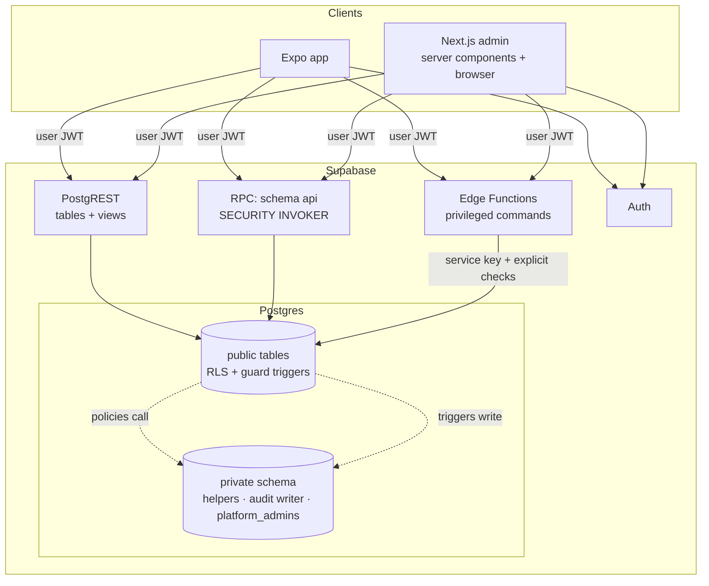

# Technical architecture — VrtićOS

- Version: 0.1 · Date: 2026-11-10 · Phase: 3
- Status: **implementation plan for the demo build**. Platform decisions D-3…D-8 remain *Proposed*; the demo runs
  **only locally** (ADR-0009), so it needs no cloud account, paid service or production data.
- Owner decision 2026-11-10: build a functional demo of the whole app before validation interviews finish.
  MVP stays unconfirmed; assumptions stay labelled (PRD §9).
- Parent docs: [../architecture.md](../architecture.md) (system context) · [database-schema.md](database-schema.md) ·
  [api-conventions.md](api-conventions.md) · [mobile-app.md](mobile-app.md) · [admin-app.md](admin-app.md) ·
  [local-development.md](local-development.md) · [../security/security-requirements.md](../security/security-requirements.md)

## 1. Guiding constraints
1. Modular monolith: one Postgres database, one repo (ADR-0002).
2. The database is the authorization boundary; clients are untrusted (ADR-0004, ADR-0005, ADR-0014).
3. No React DOM component is shared with React Native. Shared code is limited to **tokens, i18n, validation,
   types and pure domain logic**.
4. Everything runs locally with synthetic data; no paid or production service is required to develop or demo (ADR-0009).
5. Security requirements (SR-xx) are implementation inputs, not later hardening.

## 2. Monorepo layout

```
apps/
  mobile/                 Expo (React Native) app — parent + educator modes (mobile-app.md)
  admin/                  Next.js App Router admin (admin-app.md)
packages/
  config/                 tsconfig bases, ESLint flat config (incl. import-boundary rules), Prettier
  tokens/                 design tokens (source JSON) → TS constants for RN + CSS custom properties for web
  i18n/                   message catalogs (hr; it later), ICU formatting helpers, date/time in Europe/Zagreb
  validation/             Zod schemas for every RPC/Edge Function input and form; error code catalog
  db-types/               generated Supabase types (`supabase gen types`) — never edited by hand
  domain/                 pure TS: attendance state machine, local-date semantics, permission catalog constants
  supabase-client/        typed client factories (browser, server, native) without UI; no service key code
  test-fixtures/          synthetic "Alfa/Beta" world shared by seed, pgTAP generators and e2e
supabase/
  config.toml             local stack config (auth, email via Mailpit, MFA TOTP on)
  migrations/             SQL migrations — the only way to change schema
  functions/              Edge Functions (Deno): invitations, notifications dispatch (later), exports (Phase 12)
  tests/                  pgTAP: catalog checks (ST-RLS-00), permission matrix, NEG-01…15
  seed/                   synthetic seed SQL generated from packages/test-fixtures
docs/
```

**Boundary rules (enforced by ESLint):** `apps/*` may import `packages/*`; `packages/*` never import `apps/*`;
`packages/{tokens,i18n,validation,db-types,domain}` must not import `react`, `react-native` or `react-dom`;
`apps/mobile` must not import `next` or `react-dom`; nothing outside `supabase/functions` may reference the
service/secret key (SR-SUP-04).

## 3. Technology choices
Versions are the npm `latest` tags observed on 2026-11-10; they are **pinned in the Phase 5 foundation spike**
(lockfile), not upgraded implicitly.

| Area | Choice | Observed version | Notes |
|---|---|---|---|
| Package manager | pnpm via Corepack, pinned in `packageManager` | 12.18.0 | **Verified in D0** (ADR-0016): isolated layout works with Expo; always via Corepack |
| Build orchestration | Turborepo | 2.11.10 | Local cache only; no remote cache (no Vercel account) |
| Language | TypeScript `strict` + `noUncheckedIndexedAccess` | **6.0.3** (7.0.2 rejected) | ADR-0016: typescript-eslint does not support TS 7; Expo SDK 58 template pins ~6.0.3 |
| Mobile | Expo SDK 58, React Native 0.88, Expo Router | expo 58.0.23, RN 0.88.1, expo-router 58.0.30 | ADR-0006, ADR-0015 |
| Web admin | Next.js App Router | 16.4.6 | ADR-0006 |
| React | 19.x | 19.3.1 | Version dictated by Expo SDK; admin aligns |
| Backend | Supabase (Postgres 17, PostgREST, GoTrue Auth, Storage, Edge Runtime) | CLI 3.1.0; postgres image 17.6.1.054 | Local via Docker (ADR-0009) |
| Supabase client | `@supabase/supabase-js`, `@supabase/ssr` (admin) | 2.119.0, 0.12.7 | |
| Validation | Zod | 4.6.7 | One schema per command, shared client/server |
| Server state | TanStack Query | 5.107.1 | ADR-0015 |
| i18n | i18next + react-i18next | 27.1.1, 18.0.1 | ICU plural rules for Croatian |
| Secure storage | expo-secure-store | 58.0.2 | SR-SESS-01 |
| Offline queue | expo-sqlite (encrypted payload) | 58.0.15 | ADR-0012 |
| Lists | @shopify/flash-list | 2.3.3 | Group lists, message threads |
| Error monitoring | Sentry (`@sentry/react-native`, `@sentry/nextjs`) | 8.34.0, 11.11.0 | **Disabled locally** (no DSN). Enabled only after D-7 |
| Unit tests | Vitest | 5.1.0 | packages + admin |
| DB tests | pgTAP (bundled in Supabase Postgres) | — | security-test-plan L1/L2 |
| E2E | Playwright (admin), Maestro (mobile) | 1.65.0, — | Maestro needs emulator; not in the cloud dev container |
| CI | GitHub Actions | — | §7 |

## 4. Data access architecture



| Path | Use for | Security rule |
|---|---|---|
| **PostgREST tables/views** | Reads; simple single-table writes (attendance check-in, absence report, message send, admin CRUD) | RLS on every table; guard triggers for column-level rules; views `security_invoker` (SR-TEN-06) |
| **RPC in `api` schema** | Multi-step transactional commands the caller is already allowed to do step by step (transfer child, publish announcement, cancel absence) | `SECURITY INVOKER` only (SR-API-02); input validated in SQL + Zod |
| **Edge Functions** | Operations needing Auth admin or external I/O: create/accept invitation, send email, dispatch push (later), DSR export (Phase 12) | User JWT client by default; service key only inside function with explicit authorization and audit (SR-EF-01…03) |
| **Triggers (definer)** | Audit events, notification fan-out, profile bootstrap, derived columns (`local_date`) | Live in `private`, fixed `search_path`, no client EXECUTE (SR-API-01) |

Realtime is **off** for the demo (SR-API-05); clients refetch on focus and pull-to-refresh. Revisit for messages.

## 5. Shared packages in practice
- **tokens:** one JSON source → `tokens.ts` (RN `StyleSheet` values) and `tokens.css` (CSS variables). Values come
  from Phase 4 (DESIGN.md); until then a neutral placeholder set that is **not** shipped as the brand.
- **i18n:** keys namespaced by module (`attendance.checkIn.title`); `hr` complete, `it` empty but structurally present;
  CI check fails on missing `hr` keys.
- **validation:** `packages/validation/src/<module>.ts` exports `zXxxInput` schemas and inferred types; Edge
  Functions import the same schemas (Deno via npm specifier).
- **domain:** pure functions with unit tests (e.g. `attendanceStatusForDay(events)`, `orgLocalDate(now, tz)`);
  SQL remains the authority for authorization — domain code never decides access.

## 6. Error handling and monitoring
- Error envelope and codes: [api-conventions.md](api-conventions.md) §4.
- Clients map codes to i18n messages; unknown errors show a generic message with a correlation ID.
- Sentry (after D-7 approval): `sendDefaultPii: false`, `beforeSend` scrubber removing request bodies, query
  strings, breadcrumbs of `console`, user identifiers except a random install ID; no session replay, no screenshots
  (SR-LOG-01). A unit test asserts the scrubber removes synthetic child names (ST-LOG-01).
- Local: errors to console only; no third-party transmission.

## 7. CI/CD (GitHub Actions)
Workflows created in Phase 5. **No deploy job exists until production decisions (D-3, D-6) are approved.**

| Job | Steps | Blocks merge |
|---|---|---|
| `quality` | pnpm install (frozen lockfile) → lint → typecheck → Vitest | yes |
| `db` | start local Supabase via Docker (Docker Hub images, ADR-0009) → apply migrations → pgTAP (catalog checks ST-RLS-00, permission matrix, NEG-01…15) → `supabase gen types` diff check | yes |
| `security` | gitleaks secret scan, `pnpm audit` (high+), license check, i18n key check | yes (secrets, high vulns) |
| `admin-build` | `next build` with dummy public env | yes |
| `mobile-check` | `expo export` (JS bundle) + typecheck; native builds deferred (EAS needs an account — not now) | yes |
| `e2e` (nightly) | Playwright against local stack + seed | no (report) |

Branch protection on `main` (owner action), required reviews, signed tags for releases later.

## 8. Environments
| Environment | Exists now | Data | Notes |
|---|---|---|---|
| local / demo | **yes** (ADR-0009) | synthetic seed only | Laptop + phones on the same Wi-Fi for kindergarten demos |
| staging | no | synthetic only | Requires D-3 |
| production | no | real (only after Phase 14 gates) | Requires D-3, D-6, D-7, legal review |

## 9. Requirement coverage (architecture → SR)
| Architecture element | Covers |
|---|---|
| RLS everywhere + composite FKs + exclusion constraints | SR-TEN-01…05, NEG-01 |
| `private` helpers, invoker RPCs, guard triggers, column grants | SR-AUTHZ-01…12, SR-API-01…03, SR-TEN-06 |
| AAL2 checks for admin roles | SR-AUTHN-07 |
| Edge Functions for invitations | SR-AUTHN-01…05, SR-EF-01…03 |
| Content-free notifications table + push later | SR-PUSH-01…03 |
| expo-secure-store, encrypted offline queue | SR-SESS-01, SR-MOB-01…02 |
| CSP + text-only rendering in admin | SR-WEB-01…04 |
| Audit triggers into append-only table | SR-AUD-01…02 |
| CI jobs §7 | SR-TEN-03, SR-SUP-01, SR-SUP-04 |
