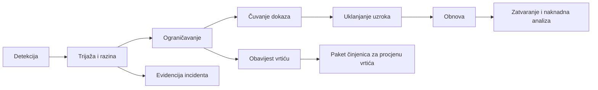

# Plan odgovora na sigurnosne incidente — VrtićOS

**Verzija:** 0.1 (nacrt) · **Datum:** 2026-11-10 · **Faza:** 2 (ograničeni opseg)
**Status:** operativni nacrt; **nije uvježban, osobe nisu imenovane, odgovornosti s vrtićima nisu dogovorene.**
Proizvod još ne postoji — plan se primjenjuje od prvog okruženja sa sintetičkim podacima nadalje (vježbe), a obvezno prije pilota.

> ⚖️ **Pravna ograničenja ovog dokumenta.** Ne utvrđuje je li VrtićOS voditelj ili izvršitelj obrade (Q-P01), ne određuje
> ugovorne rokove obavještavanja vrtića (Q-P15) i **ne donosi odluku** o obavještavanju nadzornog tijela (AZOP) ili ispitanika.
> Plan pretpostavlja (**pretpostavka IR-A1**) da je za podatke vrtića VrtićOS izvršitelj obrade, pa je njegova uloga pravodobno
> obavijestiti vrtić i pripremiti činjenice za njegovu procjenu. Ako se pretpostavka promijeni, §10–§11 se revidiraju.

**Veze:** [threat-model.md](threat-model.md) · [security-requirements.md](security-requirements.md) · [../risks.md](../risks.md) ·
[../privacy/data-inventory.md](../privacy/data-inventory.md) · [../open-questions.md](../open-questions.md)

## 1. Definicije
| Pojam | Značenje u ovom planu |
|---|---|
| Sigurnosni događaj | Bilo koje opažanje koje bi moglo upućivati na problem (upozorenje, prijava korisnika, neobičan log). |
| Sigurnosni incident | Potvrđen ili vrlo vjerojatan događaj koji ugrožava povjerljivost, cjelovitost ili dostupnost sustava ili podataka. |
| Povreda osobnih podataka | Incident koji dovodi do slučajnog ili nezakonitog uništenja, gubitka, izmjene, neovlaštenog otkrivanja ili pristupa osobnim podacima (GDPR čl. 4(12)). **Kvalifikacija konkretnog slučaja je pravna procjena** ⚖️. |
| Trenutak saznanja | Trenutak kad tim ima razumnu razinu sigurnosti da se incident dogodio — bilježi se u evidenciji jer o njemu ovise rokovi ⚖️. |

## 2. Detekcija
| Izvor | Primjeri | Tko prati |
|---|---|---|
| Monitoring i upozorenja | skok grešaka pristupa (403/401), neuspjele prijave, OTP blokade, greške Edge Functions, neočekivani izvozi | dežurna osoba [nije imenovano — Q-S07] |
| Revizijski zapis | masovne promjene skrbništva, ovlaštenih osoba ili članstava; radnje izvan uobičajenog vremena | uprava vrtića (vlastiti audit), platform tim |
| Sigurnosni testovi | neuspjeh sigurnosnog testa na kodu koji je već u produkciji | razvojni tim |
| Prijava korisnika | "vidim tuđe dijete", "dobio sam pozivnicu koja nije za mene", sumnjiva e-pošta | podrška → odmah trijaža |
| Prijava vrtića | ravnatelj/DPO uočava problem | kontakt vrtića → platform tim |
| Dobavljač | obavijest o incidentu (Supabase, hosting, Expo, e-pošta, Sentry, GitHub) | odgovorna osoba za dobavljače [nije imenovano] |
| Vanjski istraživač | prijava ranjivosti | sigurnosni kontakt (`security.txt` — Q-S13) |
| Skeniranje | secret scanning, dependency scanning | CI → razvojni tim |

**Pravilo:** svaka prijava koja upućuje na pristup podacima djeteta izvan opsega ("vidim tuđe dijete") automatski se tretira kao
**SEV-1 do suprotnog dokaza**.

## 3. Klasifikacija ozbiljnosti
Ciljana vremena su **prijedlog** za internu organizaciju, ne ugovorna obveza (SLA nije dogovoren).

| Razina | Kriterij (bilo koji) | Primjeri | Prvi odgovor (cilj) | Ograničavanje (cilj) |
|---|---|---|---|---|
| **SEV-1 Kritično** | Potvrđen ili vjerojatan pristup podacima djece izvan opsega; pristup između vrtića; curenje tajnog ključa; kompromitiran privilegirani račun ili OTA kanal; gubitak podataka | RLS pogreška izlaže skupinu drugom vrtiću; service ključ u javnom repozitoriju | odmah, ≤ 1 h | ≤ 4 h |
| **SEV-2 Visoko** | Ograničena izloženost osobnih podataka (jedna osoba/dijete); kompromitiran račun skrbnika ili odgojitelja; pozivnica pogrešnoj osobi koja je prihvaćena; push s osobnim podacima | Pogrešno povezan skrbnik vidio jedno dijete | ≤ 4 h | ≤ 24 h |
| **SEV-3 Srednje** | Ranjivost bez dokaza iskorištavanja; nedostupnost u jutarnjem vršnom satu; pokušaji napada bez uspjeha | Masovni neuspjeli pokušaji OTP-a; ranjiva ovisnost | ≤ 1 radni dan | prema planu |
| **SEV-4 Nisko** | Sigurnosni događaj bez utjecaja | Pogrešno konfigurirano upozorenje | ≤ 3 radna dana | — |

Ozbiljnost se može podići ili spustiti tijekom istrage; svaka promjena se bilježi s razlogom.

## 4. Uloge, odgovornosti i eskalacija
Osobe **nisu imenovane** (Q-S07). Mali tim: jedna osoba može imati više uloga, ali **SEV-1 zahtijeva najmanje dvije osobe**
(provjera četiri oka za destruktivne korake i komunikaciju).

| Uloga | Odgovornost | Osoba |
|---|---|---|
| Voditelj incidenta (IC) | Proglašava incident i razinu, koordinira, donosi operativne odluke, odobrava komunikaciju | [nije imenovano] |
| Tehnički voditelj | Istraga, ograničavanje, obnova, čuvanje dokaza | [nije imenovano] |
| Zapisničar | Vremenska crta, odluke, dokazi, evidencija | [nije imenovano] |
| Komunikacija | Priprema poruka vrtiću i (na zahtjev vrtića) predložaka za korisnike | [nije imenovano] |
| Savjetnik za zaštitu podataka / pravni savjet | Savjet o pravnim posljedicama za VrtićOS ⚖️ | [nije angažirano — Q-P14] |
| Kontakt vrtića | Prima obavijest, prosljeđuje DPO-u vrtića, odlučuje u ime voditelja obrade | **Dogovara se u DPA** [nije dogovoreno — Q-P15] |
| DPO vrtića | Procjena rizika za ispitanike i obveze obavještavanja (ako je vrtić voditelj ⚖️) | prema vrtiću |
| Dobavljači | Podrška istrazi u svom opsegu | kontakti u registru podizvršitelja (Faza 2) |

**Eskalacija:** prvi primatelj → IC (odmah za SEV-1/2) → vlasnik projekta (SEV-1 uvijek) → kontakt vrtića (§10) →
dobavljač (ako je uzrok ili alat istrage). Ako IC nije dostupan u ciljnom vremenu, preuzima zamjenik [nije imenovano].

## 5. Tijek odgovora

Čuvanje dokaza počinje **paralelno** s ograničavanjem — ograničavanje ne smije uništiti dokaze ako to nije nužno za
zaštitu djece; ako jest, prije destruktivnog koraka bilježi se stanje.

## 6. Ograničavanje — playbookovi
Svaki playbook: (1) zaustavi štetu, (2) sačuvaj dokaze, (3) utvrdi opseg, (4) obavijesti prema §9–§10.

| ID | Scenarij | Prvi koraci ograničavanja | Utvrđivanje opsega |
|---|---|---|---|
| P-01 | Pristup između vrtića / pogreška RLS-a ili autorizacije | Onemogućiti zahvaćenu funkciju/endpoint (feature flag, oduzimanje granta, privremena restriktivna politika); ako nije izvedivo — način održavanja za zahvaćeni modul | Koje tablice/politike, od kada (povijest migracija), koji korisnici su mogli pristupiti, logovi API zahtjeva i audit |
| P-02 | Kompromitiran račun (skrbnik, djelatnik, uprava, platform admin) | Opoziv svih sesija; deaktivacija članstva; reset MFA; provjera i poništavanje promjena napravljenih s računa (skrbništvo, ovlaštene osobe!) | Audit radnji računa; prijave i uređaji; koje podatke je račun mogao vidjeti |
| P-03 | Pogrešno povezano dijete ili pozivnica pogrešnoj osobi | Opoziv pozivnice/veze; deaktivacija članstva ako nema drugih veza; opoziv sesija | Je li pozivnica prihvaćena; što je osoba vidjela i kada (audit, API logovi) |
| P-04 | Curenje tajnog ključa (service/secret API ključ, JWT signing, ključ dobavljača, CI tajna) | **Rotacija** ključa (plan SR-OPS-05); opoziv starog; pregled korištenja ključa | Logovi korištenja ključa; je li bio javan i koliko dugo |
| P-05 | Izgubljen ili kompromitiran uređaj | Daljinska odjava (korisnik ili uprava); deaktivacija push tokena; po potrebi deaktivacija članstva | Vrsta uređaja, zaključan/otključan, neposlani offline unosi |
| P-06 | Kompromitiran lanac opskrbe / OTA / CI | Zaustaviti pipeline i objave; povući ažuriranje (rollback kanala); rotirati CI tajne | Koji buildovi/ažuriranja su objavljeni, koliko uređaja ih je primilo |
| P-07 | Incident kod dobavljača | Primijeniti upute dobavljača; rotirati ključeve kod tog dobavljača; procijeniti potrebu za isključenjem integracije | Koji podaci su kod dobavljača (inventar DI-xx, registar podizvršitelja) |
| P-08 | Gubitak ili uništenje podataka (brisanje, pogrešna migracija, ransomware) | Zaustaviti pisanje u zahvaćeni dio; ne prepisivati stanje; pripremiti point-in-time restore | Vremenska točka zadnjeg ispravnog stanja; koje promjene treba ponovno unijeti |
| P-09 | Neovlašten pristup datotekama / proslijeđen potpisani URL | Brisanje ili premještanje objekta (potpisani URL se ne može pojedinačno opozvati — R-28); po potrebi rotacija ključa za potpisivanje | Tko je dobio URL; logovi pristupa Storageu |
| P-10 | Push/e-pošta s osobnim podacima ili lažne obavijesti | Zaustaviti slanje (outbox); ispraviti predložak; rotirati push pristupni token ako je zlouporaba | Broj poslanih poruka, primatelji, sadržaj |

## 7. Zaštita i čuvanje dokaza
- **Što:** vremenska crta; izvozi relevantnih logova (auth, API, Edge Functions, Storage, hosting); audit zapisi; povijest migracija i
  deployova; konfiguracija (politike, grantovi, bucketi) u trenutku incidenta; snimka baze (PITR točka) prije obnove; komunikacija s dobavljačima.
- **Kako:** dokazi se izvoze u zaštićenu pohranu s ograničenim pristupom (samo uloge iz §4); svakoj datoteci se bilježi
  hash (npr. SHA-256), vrijeme i tko ju je preuzeo (lanac čuvanja); izvorni logovi se ne mijenjaju.
- **Minimizacija:** dokazi sadrže osobne podatke samo koliko je nužno za istragu; ne dijele se u chatu ni e-poštom; u evidenciji
  incidenta koriste se ID-ovi, ne imena djece.
- **Rizik:** zadržavanje logova kod dobavljača može biti kratko (ovisi o planu) — bez unaprijed postavljenog izvoza logova
  dokazi mogu nestati prije istrage (R-32, SR-LOG-03, Q-S08). Prvi korak svake istrage je **odmah izvesti logove**.
- **Rok čuvanja dokaza:** ⚖️ otvoreno (Q-P09).

## 8. Obnova sustava
1. Uzrok uklonjen i potvrđen (npr. ispravljena politika + negativni test koji bi uhvatio pogrešku — dodaje se u ST paket).
2. Za gubitak podataka: point-in-time restore u **zaseban** projekt/okruženje, provjera, zatim kontrolirani povrat (ne izravno prepisivanje produkcije).
3. Ponovno uključivanje funkcije postupno, uz pojačan nadzor.
4. Provjera: sigurnosni testovi (L1–L3) prolaze na obnovljenom sustavu; audit i logovi teku.
5. Ručni rezervni postupci vrtića (NFR-REL-02) ostaju aktivni dok IC ne potvrdi normalan rad.
6. Ključevi rotirani gdje postoji sumnja na izloženost.

## 9. Interna komunikacija
- Zaseban privatni kanal po incidentu; pristup samo ulogama iz §4.
- **Bez osobnih podataka u kanalu** — ID-ovi i oznake (npr. "dijete #a1b2"), ne imena.
- Status svakih 60 min za SEV-1 dok traje ograničavanje, zatim prema dogovoru; za SEV-2 najmanje dnevno.
- Odluke se upisuju u vremensku crtu (tko, što, zašto, kada).

## 10. Komunikacija s vrtićem
Pod pretpostavkom IR-A1 (VrtićOS = izvršitelj ⚖️), GDPR čl. 33(2) traži da izvršitelj obavijesti voditelja **bez nepotrebnog
odgađanja** nakon saznanja za povredu osobnih podataka. Točan ugovorni rok i kanal **nisu dogovoreni** (Q-P15).

- **Kome:** kontakt vrtića i DPO vrtića definirani u DPA [nije dogovoreno]; svaki zahvaćeni vrtić zasebno — poruka vrtiću
  Alfa nikad ne sadrži podatke vrtića Beta.
- **Kada (prijedlog za DPA):** prva obavijest čim je SEV-1/SEV-2 s mogućom povredom osobnih podataka potvrđen, i ako sve
  informacije još nisu poznate (dopune slijede postupno).
- **Što:** paket činjenica iz §11; što je učinjeno; što vrtić treba odlučiti; kontakt IC-a.
- **Kanal:** dogovoreni siguran kanal; bez osobnih podataka u e-pošti ako nije zaštićena — po potrebi popis zahvaćenih ID-ova kroz zaštićen kanal.
- **Ispitanici (roditelji, djelatnici):** VrtićOS ih **ne kontaktira samostalno** o povredi, osim po uputi vrtića (pretpostavka IR-A2 ⚖️).
  Na zahtjev vrtića VrtićOS priprema predložak obavijesti i tehničku pomoć (npr. obavijest u aplikaciji).
- **Mediji i javnost:** nikakva izjava bez odobrenja vlasnika projekta i usklađivanja sa zahvaćenim vrtićem.

## 11. Priprema za procjenu obveze obavještavanja nadzornog tijela i ispitanika
VrtićOS **ne odlučuje** o obavještavanju AZOP-a (čl. 33) ni ispitanika (čl. 34) ⚖️. Priprema činjenice koje voditelj
treba za svoju procjenu, strukturirane prema sadržaju koji čl. 33(3) navodi:

| Stavka | Sadržaj koji VrtićOS priprema |
|---|---|
| Priroda incidenta | Što se dogodilo, kako je otkriveno, trenutak saznanja, trajanje izloženosti |
| Kategorije ispitanika | djeca, skrbnici, djelatnici, ovlaštene osobe (inventar) |
| Približan broj ispitanika i zapisa | Po vrtiću, s metodom izračuna i nesigurnošću |
| Kategorije podataka | DI-xx retci i razina osjetljivosti (R1–R5); je li uključen R4 (ograničenja, poruke) |
| Kome su podaci mogli biti otkriveni | Drugi vrtić, drugi skrbnik, javnost, nepoznato |
| Vjerojatne posljedice (činjenice) | Npr. otkrivena lokacija/raspored djeteta, otkrivene obiteljske okolnosti — kao činjenice za procjenu rizika vrtića, bez pravnog zaključka |
| Poduzete i predložene mjere | Ograničavanje, obnova, rotacije, mjere za ublažavanje štete za ispitanike |
| Kontakt | IC i tehnička kontakt osoba |

Napomena za voditelja (informativno, ⚖️): podaci o djeci i podaci koji otkrivaju lokaciju/raspored djeteta mogu povećati
procjenu rizika; obveza i rokovi prema nadzornom tijelu i ispitanicima ovise o procjeni voditelja i pravnom savjetu.

## 12. Evidencija incidenta
Svaki SEV-1 do SEV-3 (i svaki događaj koji je razmatran kao moguća povreda) upisuje se u evidenciju incidenata
(lokacija i alat [otvoreno]; ne u javni repozitorij).

| Polje | Opis |
|---|---|
| ID, razina, status | npr. INC-2027-001, SEV-2, zatvoren |
| Vremena | prvi signal, trenutak saznanja, proglašenje, obavijest vrtiću, ograničenje, obnova, zatvaranje |
| Opis i uzrok | bez imena djece/korisnika (ID-ovi) |
| Zahvaćeni vrtići, kategorije podataka i ispitanika, broj | |
| Odluke i obrazloženja | uključujući zašto nešto **nije** proglašeno povredom ili nije obaviješteno |
| Komunikacija | kome, kada, kojim kanalom |
| Dokazi | popis s hashevima i lokacijom |
| Akcije | popravci, testovi, promjene dokumentacije, vlasnik i status |

Rok čuvanja evidencije: ⚖️ otvoreno (Q-P09). Voditelj obrade vodi vlastitu evidenciju povreda (čl. 33(5)); evidencija VrtićOS-a
služi kao izvor činjenica za nju.

## 13. Naknadna analiza
- Za svaki SEV-1/SEV-2 u roku od 10 radnih dana (prijedlog); bez traženja krivca (blameless).
- Sadržaj: vremenska crta, uzrok (i doprinoseći faktori), što je pomoglo, što nije, akcije s vlasnicima.
- Obvezne akcije: novi ili izmijenjeni sigurnosni test (ST) koji bi otkrio uzrok; ažuriranje [threat-model.md](threat-model.md),
  [../risks.md](../risks.md) i ovog plana ako je potrebno; backlog stavke.
- Sažetak zahvaćenim vrtićima prema dogovoru.

## 14. Pripravnost (prije pilota)
| Stavka | Status |
|---|---|
| Imenovane osobe za uloge iz §4 i zamjenici | ❌ (Q-S07) |
| Kontakti vrtića i dobavljača za incidente | ❌ (DPA, registar podizvršitelja) |
| Izvoz logova i rok zadržavanja | ❌ (Q-S08, SR-LOG-03) |
| Postupak rotacije ključeva dokumentiran i isproban | ❌ (SR-OPS-05) |
| PITR restore isproban u zasebnom okruženju | ❌ (R-22) |
| Feature flagovi / način održavanja po modulu za brzo ograničavanje | ❌ (backlog P5-13) |
| Tabletop vježba s barem P-01, P-03 i P-04 | ❌ (backlog P13-1) |
| Sigurnosni kontakt (`security.txt`) i postupak za prijave ranjivosti | ❌ (Q-S13) |
| Dogovoren rok i kanal obavještavanja vrtića u DPA | ❌ (Q-P15 ⚖️) |

## 15. Otvorena pitanja
Q-S07 (osobe i dežurstvo), Q-S08 (logovi), Q-S13 (sigurnosni kontakt), Q-P01 (uloga VrtićOS-a), Q-P09 (rokovi čuvanja),
Q-P14 (DPO/savjetnik VrtićOS-a), Q-P15 (rok i kanal obavještavanja vrtića) — vidi [../open-questions.md](../open-questions.md).
