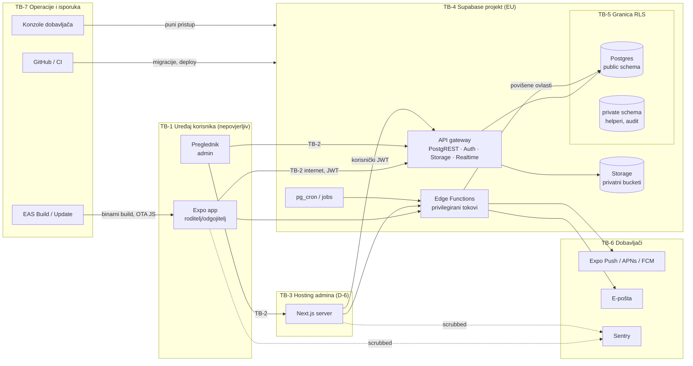

# Threat model — VrtićOS (MVP)

**Verzija:** 0.1 (nacrt) · **Datum:** 2026-11-10 · **Faza:** 2 (ograničeni opseg) · **Metoda:** STRIDE po komponenti i granici povjerenja
**Status:** nacrt za pregled; nije sigurnosna potvrda. MVP **nije zaključan** — model pokriva Must i Should module iz
[../product/functional-specs.md](../product/functional-specs.md) i namjerno uključuje fotografije/datoteke (izvan MVP-a) jer
Storage postoji već za izvoze zahtjeva ispitanika (FS-15).
**Veze:** [security-requirements.md](security-requirements.md) (SR-xx) · [security-test-plan.md](security-test-plan.md) (ST-xx) ·
[incident-response-plan.md](incident-response-plan.md) · [../risks.md](../risks.md) · [../architecture.md](../architecture.md)

## 0. Pretpostavke modela (SA)
Model se odnosi na **predloženu** arhitekturu. Nijedna od ovih odluka nije odobrena; ako se promijeni, model se revidira.

| ID | Pretpostavka | Ovisi o | Ako se promijeni |
|---|---|---|---|
| SA-01 | Backend je Supabase Cloud u EU regiji (Postgres + PostgREST + Auth + Storage + Edge Functions) | D-3 / ADR-0003 (Proposed) | Revidirati §3–§5 za novi backend; prijetnje autorizacije ostaju |
| SA-02 | Klijenti pristupaju bazi izravno s korisničkim JWT-om; RLS je glavna granica autorizacije | D-4, D-5 / ADR-0004, 0005 | Ako se uvede vlastiti API sloj, dio kontrola seli se u njega |
| SA-03 | Jedna Expo aplikacija (roditelj + odgojitelj) i Next.js admin; hosting admina nije odlučen | D-6 / ADR-0006 | Vercel vs. EU host mijenja podizvršitelje i logove (T-VEN) |
| SA-04 | Push preko Expo Push → APNs/FCM; e-pošta preko (EU) pružatelja; Sentry s EU regijom | D-7 / ADR-0007 | Promjena dobavljača mijenja T-PUSH, T-VEN |
| SA-05 | Prijava: pozivnica + e-mail OTP; TOTP MFA obvezan za upravu i platform admina | D-8 / ADR-0008 | SMS/lozinke uvode nove prijetnje (SIM swap, credential stuffing) |
| SA-06 | Platform admin nema pristup podacima djece u proizvodu; break-glass nije u MVP-u | ADR-0005, FR-09-5 | Break-glass zahtijeva zaseban threat model |
| SA-07 | Uređaji odgojitelja: osobni ili službeni — **nepoznato** | Q-T03 | Zajednički tablet → dodatne prijetnje (T-DEV-05) |
| SA-08 | Uloga voditelja/izvršitelja obrade nije utvrđena ⚖️ | Q-P01 | Utječe samo na incidentni plan (komunikacija), ne na tehničke kontrole |

## 1. Opseg i imovina

| ID | Imovina | Osjetljivost (inventar) | Zašto je meta |
|---|---|---|---|
| AS-01 | Podaci o djeci: identitet, upis, dolasci, izostanci | R3 (DI-09, 10, 14–16) | Sigurnost djeteta (tko je gdje i kada), privatnost obitelji |
| AS-02 | Visoko osjetljivi podaci: ograničenja pristupa, poruke | R4 (DI-12, DI-19) | Otkrivaju obiteljske/sudske okolnosti; poruke mogu sadržavati bilo što |
| AS-03 | Ovlaštene osobe za preuzimanje | R3 (DI-13) | Manipulacija popisom → predaja djeteta pogrešnoj osobi |
| AS-04 | Računi, sesije, OTP, MFA faktori | R2 (DI-01, DI-06) | Ulaz u sve ostalo |
| AS-05 | Tajni ključevi: service/secret API ključ, JWT signing ključ, ključevi dobavljača, CI tajne | — | Zaobilaze RLS u potpunosti |
| AS-06 | Revizijski zapis | R3 (DI-22) | Integritet dokaza; brisanje prikriva napad |
| AS-07 | Izvozi zahtjeva ispitanika, uvozne datoteke | R3/R4 (DI-23) | Koncentrirani podaci u jednoj datoteci |
| AS-08 | Sigurnosne kopije | R4 (DI-27) | Kopija svega |
| AS-09 | Kanal obavijesti (push, e-pošta) | DI-07 | Povjerenje roditelja — zlouporaba za phishing |
| AS-10 | Integritet aplikacije (build, OTA ažuriranja, ovisnosti) | — | Kompromitacija jednog kanala = kod na svim uređajima |
| AS-11 | Dostupnost jutarnje evidencije | — | Operativni rad vrtića |

## 2. Akteri prijetnje

| ID | Akter | Primjer motivacije/mogućnosti |
|---|---|---|
| AC-EXT | Vanjski napadač, bez računa | Masovni napadi, skeniranje, phishing, credential stuffing |
| AC-GRD | Zlonamjeran ili znatiželjan skrbnik (legitiman račun) | Pokušaj gledanja tuđe djece; roditelj u sporu oko skrbi pokušava doći do podataka unatoč ograničenju |
| AC-STF | Zaposlenik vrtića izvan svog opsega | Odgojitelj druge skupine, bivši zaposlenik, zamjena nakon isteka |
| AC-ADM | Zlonamjeran/kompromitiran administrator vrtića | Masovni izvoz, promjena skrbničkih veza, brisanje tragova |
| AC-OPS | Član VrtićOS tima / operator platforme | Pristup kroz konzolu dobavljača zaobilazi RLS i audit aplikacije |
| AC-TEN | Korisnik drugog vrtića | Pristup podacima drugog tenanta |
| AC-SUP | Kompromitiran dobavljač ili paket | Zlonamjerni npm paket, kompromitiran CI, OTA kanal |
| AC-THF | Kradljivac/nalaznik uređaja | Fizički pristup otključanom ili zaključanom telefonu |

## 3. Komponente i granice povjerenja

| Granica | Između | Što prelazi | Ključna pretpostavka |
|---|---|---|---|
| TB-1 | Korisnik ↔ njegov uređaj | sve na uređaju | Uređaj može biti izgubljen, dijeljen, zastario ili rootan; klijentski kod je pod kontrolom napadača |
| TB-2 | Internet ↔ Supabase / hosting | JWT, zahtjevi | Javni (publishable/anon) ključ je javan; **nije** tajna ni kontrola pristupa |
| TB-3 | Preglednik ↔ Next.js server | kolačići sesije | Server ne drži service ključ; djeluje u ime korisnika (ADR-0006) |
| TB-4 | API gateway ↔ baza/Storage | SQL/objekti | Sve izložene sheme dostupne su svakom autentificiranom korisniku osim gdje RLS/grantovi kažu drugačije |
| TB-5 | Izložena `public` shema ↔ `private` shema | pozivi helpera | `SECURITY DEFINER` funkcije i audit nisu izravno dohvatljive iz API-ja |
| TB-6 | VrtićOS ↔ dobavljači | tokeni, generičke obavijesti, e-pošta, scrubbed greške | Dobavljači ne dobivaju podatke o djeci |
| TB-7 | Tim/CI ↔ produkcija | kod, migracije, tajne, konzole | Najprivilegiraniji put; zaobilazi sve aplikacijske kontrole |
| TB-8 | Tenant ↔ tenant | — | Logička granica unutar iste baze (ADR-0004) |

## 4. STRIDE analiza

Oznake: **V** vjerojatnost, **U** utjecaj (1–5) **prije** mitigacija. Mitigacije su sigurnosni zahtjevi (SR) iz
[security-requirements.md](security-requirements.md); testovi (ST) iz [security-test-plan.md](security-test-plan.md).

### 4.1 Multi-tenant izolacija (TB-8)
| ID | STRIDE | Prijetnja | V | U | Mitigacije | Testovi |
|---|---|---|---|---|---|---|
| T-TEN-01 | I | Tablica bez RLS-a ili s `USING (true)` politikom izlaže sve vrtiće | 3 | 5 | SR-TEN-01, 02, 03 | ST-RLS-00, ST-TEN-01 |
| T-TEN-02 | T | Zapis vrtića Alfa referencira zapis Bete (npr. upis D9 u S1) | 2 | 5 | SR-TEN-04 (kompozitni FK), SR-TEN-05 | ST-TEN-04 |
| T-TEN-03 | I | `organization_id` poslan iz klijenta prihvaćen bez provjere članstva (insert u tuđi vrtić) | 3 | 5 | SR-TEN-05 (WITH CHECK), SR-AUTHZ-01 | ST-TEN-03 |
| T-TEN-04 | I | View, materializirani view ili RPC zaobilazi RLS (view se izvodi s pravima vlasnika) | 3 | 5 | SR-TEN-06 (`security_invoker`), SR-API-02 | ST-RLS-00, ST-TEN-06 |
| T-TEN-05 | I | Otkrivanje postojanja zapisa drugog vrtića kroz različite poruke grešaka, brojače ili FK greške | 2 | 3 | SR-API-04 | ST-TEN-07 |
| T-TEN-06 | I | Realtime pretplata ili pretraga vraća podatke drugih vrtića | 2 | 5 | SR-API-05, SR-TEN-01 | ST-TEN-08 |
| T-TEN-07 | I | Korisnik s članstvom u dva vrtića vidi miješane podatke (kontekst klijenta zamijenjen za autorizaciju) | 3 | 4 | SR-AUTHZ-02 | ST-TEN-05 |

### 4.2 Autentikacija i sesije (FS-01)
| ID | STRIDE | Prijetnja | V | U | Mitigacije | Testovi |
|---|---|---|---|---|---|---|
| T-AUTH-01 | S | Brute force ili pogađanje OTP koda | 2 | 4 | SR-AUTHN-02 | ST-AUTH-01 |
| T-AUTH-02 | I | Enumeracija računa kroz prijavu/pozivnice (različiti odgovori) | 3 | 2 | SR-AUTHN-03 | ST-AUTH-02 |
| T-AUTH-03 | S | Preuzimanje e-pošte skrbnika = preuzimanje računa (e-pošta je jedini faktor za roditelje) | 3 | 4 | SR-AUTHN-06 (obavijest o novoj prijavi), SR-SESS-03; **preostali rizik R-06** | ST-AUTH-06 |
| T-AUTH-04 | S | Pozivnica poslana na pogrešnu e-poštu → nepozvana osoba vidi dijete | 3 | 5 | SR-AUTHN-04, SR-AUTHN-05 (opcija: kod predan u vrtiću, Q-S11) | ST-AUTH-03 |
| T-AUTH-05 | S | Ponovna uporaba ili presretanje pozivnice/magic linka (custom URL scheme hijack na Androidu) | 2 | 4 | SR-AUTHN-01 (OTP kod umjesto linka s tokenom), SR-MOB-04 | ST-AUTH-04 |
| T-AUTH-06 | E | Administrator bez MFA (krađa e-pošte → pristup svim podacima vrtića) | 3 | 5 | SR-AUTHN-07 (AAL2 u politikama) | ST-PRIV-01 |
| T-AUTH-07 | S | Phishing stranica oponaša prijavu/e-poštu vrtića | 3 | 4 | SR-OPS-06 (SPF/DKIM/DMARC), SR-AUTHN-01 (OTP se unosi samo u app) | — (operativno) |
| T-SESS-01 | S | Krađa refresh/access tokena s uređaja ili iz preglednika (XSS, malware) | 3 | 4 | SR-SESS-01, SR-WEB-01, SR-WEB-02 | ST-SESS-01 |
| T-SESS-02 | E | Opozvan korisnik zadržava pristup do isteka JWT-a | 4 | 4 | SR-AUTHZ-03 (autorizacija iz DB stanja), SR-SESS-02 (kratak JWT), SR-SESS-04 | ST-REV-01…06 |
| T-SESS-03 | R | Korisnik poriče radnju (npr. ispravak dolaska) | 2 | 3 | SR-AUD-01, 02 | ST-AUD-01 |

### 4.3 Autorizacija po ulogama (ADR-0005)
| ID | STRIDE | Prijetnja | V | U | Mitigacije | Testovi |
|---|---|---|---|---|---|---|
| T-AZ-01 | I | Skrbnik dohvaća tuđe dijete promjenom ID-a (IDOR) | 4 | 5 | SR-AUTHZ-04, SR-TEN-01 | ST-GRD-01…08 |
| T-AZ-02 | I | Skrbnik s aktivnim ograničenjem i dalje vidi dijete (obavijesti, status dolaska, razgovor) | 3 | 5 | SR-AUTHZ-05 | ST-GRD-05 |
| T-AZ-03 | I | Odgojitelj vidi djecu izvan skupine ili nakon kraja zamjene/rasporeda | 3 | 4 | SR-AUTHZ-06 | ST-EDU-01…07 |
| T-AZ-04 | E | Korisnik mijenja vlastitu ulogu/članstvo/zastavice skrbništva | 2 | 5 | SR-AUTHZ-07 | ST-PRIV-03 |
| T-AZ-05 | E | Politika koristi korisniku uredive podatke (`user_metadata`) za autorizaciju | 2 | 5 | SR-AUTHZ-08 | ST-RLS-00 |
| T-AZ-06 | E | Skrbnik uređuje popis ovlaštenih osoba za preuzimanje i dodaje osobu bez provjere vrtića | 2 | 5 | SR-AUTHZ-09 | ST-GRD-07 |
| T-AZ-07 | I | Platform admin čita podatke djece kroz proizvod | 2 | 5 | SR-PRIV-01 | ST-PRIV-02 |
| T-AZ-08 | E | Odgojitelj objavljuje obavijest cijelom vrtiću / uprava druge organizacije | 2 | 3 | SR-AUTHZ-10 | ST-EDU-06 |
| T-AZ-09 | I | Uprava čita razgovore prije odluke Q-T16 | 2 | 4 | SR-AUTHZ-11 | ST-PRIV-05 |
| T-AZ-10 | T | Neovlašten ispravak evidencije dolazaka (prikrivanje kašnjenja/greške) | 2 | 4 | SR-AUTHZ-12, SR-AUD-01 | ST-EDU-05 |

### 4.4 API, PostgREST, RPC i Edge Functions (TB-4, TB-5)
| ID | STRIDE | Prijetnja | V | U | Mitigacije | Testovi |
|---|---|---|---|---|---|---|
| T-API-01 | E | `SECURITY DEFINER` funkcija u izloženoj shemi (ili s `EXECUTE` za PUBLIC) poziva se izravno kao RPC i zaobilazi RLS | 3 | 5 | SR-API-01, SR-API-02 | ST-RLS-00 |
| T-API-02 | E | Edge Function koristi service ključ i ne provjerava ovlast pozivatelja (confused deputy) | 3 | 5 | SR-EF-01, SR-EF-02 | ST-EF-01…03 |
| T-API-03 | T | Mass assignment: klijent šalje polja koja ne smije postaviti (`recorded_by`, `organization_id`, `status`) | 3 | 4 | SR-API-03 | ST-TEN-03, ST-API-01 |
| T-API-04 | D | Skupi upiti, neograničeno paginiranje, masovni zahtjevi u jutarnjem vršnom satu | 2 | 3 | SR-API-06, SR-API-07 | ST-API-02 |
| T-API-05 | I | Greške/stack trace vraćaju SQL, nazive tablica ili podatke | 2 | 2 | SR-API-04, SR-LOG-02 | ST-API-03 |
| T-API-06 | S | Edge Function bez provjere JWT-a ili s permisivnim CORS-om pozvana s tuđe stranice | 2 | 4 | SR-EF-03 | ST-EF-04 |
| T-API-07 | I | Tajne u kodu Edge Functions, logovima ili repozitoriju | 2 | 5 | SR-SUP-04, SR-OPS-02 | ST-OPS-01 |
| T-API-08 | T | Ponovljeni zahtjevi (offline red) stvaraju duple ili konfliktne zapise | 3 | 2 | SR-API-08 (idempotentnost) | AC-05-2 |

### 4.5 Storage, fotografije i dokumenti
U MVP-u Storage sadrži samo **izvoze zahtjeva ispitanika** (FS-15) i eventualno **uvozne CSV datoteke** (FR-04-10, Should).
Fotografije su izvan MVP-a (D-15), ali prijetnje su navedene jer određuju dizajn bucketa unaprijed.

| ID | STRIDE | Prijetnja | V | U | Mitigacije | Testovi |
|---|---|---|---|---|---|---|
| T-STO-01 | I | Bucket greškom označen kao javni | 2 | 5 | SR-STO-01 | ST-STO-01 |
| T-STO-02 | I | Storage politika dopušta čitanje po putanji drugog vrtića/djeteta | 3 | 5 | SR-STO-02 | ST-STO-02, 03 |
| T-STO-03 | I | Potpisani URL je token nositelja: proslijeđen, spremljen u povijest/logove ili predug; **ne može se opozvati pojedinačno** | 3 | 4 | SR-STO-03, SR-STO-04 (brisanje objekta nakon preuzimanja); **preostali rizik R-28** | ST-STO-04, 05 |
| T-STO-04 | T | Zlonamjerna uvozna datoteka (CSV/formula injection, ogromna datoteka, pogrešan MIME) | 2 | 3 | SR-STO-05 | ST-STO-06 |
| T-STO-05 | I | Izvoz zahtjeva ispitanika sadrži podatke druge osobe/djeteta | 2 | 5 | SR-STO-06 | AC-15-1, ST-STO-07 |
| T-STO-06 | I | (Kasnije) fotografija s više djece prikazana skrbniku bez provjere za svako dijete; EXIF/GPS u datoteci | — | 5 | Specifikacija Faze 11; SR-STO-07 | izvan MVP-a |
| T-STO-07 | I | HTML izvoz (čitljiva verzija) izvršava sadržaj iz korisničkog teksta (XSS u izvozu) | 2 | 3 | SR-STO-06 | ST-STO-07 |

### 4.6 Push obavijesti i e-pošta (TB-6)
| ID | STRIDE | Prijetnja | V | U | Mitigacije | Testovi |
|---|---|---|---|---|---|---|
| T-PUSH-01 | I | Push sadrži ime djeteta, skupinu ili sadržaj → vidljivo na zaključanom ekranu i dobavljačima | 3 | 4 | SR-PUSH-01 | ST-PUSH-01 |
| T-PUSH-02 | S | Ukradeni push token koristi se za slanje lažnih obavijesti (phishing roditelja) | 2 | 3 | SR-PUSH-02 (zahtijevati pristupni token za slanje kod Expo Push) | ST-PUSH-02 |
| T-PUSH-03 | I | Push dolazi na uređaj nakon odjave / na bivši uređaj | 3 | 2 | SR-PUSH-03 | ST-PUSH-03 |
| T-PUSH-04 | I | Deep link iz obavijesti otvara sadržaj bez provjere autorizacije | 2 | 4 | SR-MOB-04 | ST-PUSH-04 |
| T-MAIL-01 | I | E-pošta (pozivnica, OTP) sadrži osobne podatke o djetetu | 2 | 3 | SR-AUTHN-04 | AC-01-1 |
| T-MAIL-02 | S | Lažna e-pošta u ime VrtićOS-a/vrtića | 3 | 3 | SR-OPS-06 | — |

### 4.7 Mobilni uređaj — izgubljen, ukraden, dijeljen ili kompromitiran (TB-1)
| ID | STRIDE | Prijetnja | V | U | Mitigacije | Testovi |
|---|---|---|---|---|---|---|
| T-DEV-01 | I | Izgubljen otključan telefon odgojitelja: pristup popisu djece, dolascima, porukama | 3 | 4 | SR-MOB-01, SR-SESS-03 (daljinska odjava), SR-MOB-05 (opcionalno zaključavanje app) | ST-DEV-01 |
| T-DEV-02 | I | Tokeni i lokalna predmemorija u nešifriranoj pohrani (AsyncStorage, SQLite offline red) | 3 | 4 | SR-MOB-01, SR-MOB-02 | ST-DEV-02 |
| T-DEV-03 | I | Snimka ekrana u app switcheru / screenshotovi / sigurnosne kopije uređaja sadrže podatke | 3 | 2 | SR-MOB-03 | ST-DEV-03 |
| T-DEV-04 | T | Rootan/modificiran uređaj ili izmijenjen klijent šalje proizvoljne zahtjeve | 3 | 3 | SA-02: klijent je nepovjerljiv; sve kontrole na poslužitelju | cijeli ST-RLS paket |
| T-DEV-05 | I | Zajednički tablet: sljedeći odgojitelj vidi sesiju prethodnog (ovisi o Q-T03) | 3 | 3 | SR-MOB-06 | ST-DEV-04 |
| T-DEV-06 | I | Neposlani offline unosi ostaju na uređaju nakon odjave ili gubitka | 2 | 3 | SR-MOB-02, FR-05-8 | AC-05-5 |

### 4.8 Admin web (TB-3)
| ID | STRIDE | Prijetnja | V | U | Mitigacije | Testovi |
|---|---|---|---|---|---|---|
| T-WEB-01 | E | XSS kroz korisnički tekst (obavijesti, nazivi, poruke) krade sesiju uprave | 3 | 5 | SR-WEB-01, SR-WEB-02 | ST-WEB-01 |
| T-WEB-02 | T | CSRF na mutacije (server actions, route handlers) | 2 | 4 | SR-WEB-03 | ST-WEB-02 |
| T-WEB-03 | I | Server rendera podatke s pogrešnim (dijeljenim/predmemoriranim) kontekstom korisnika | 2 | 5 | SR-WEB-04 | ST-WEB-03 |
| T-WEB-04 | I | Clickjacking admin sučelja | 1 | 3 | SR-WEB-02 (frame-ancestors) | ST-WEB-01 |

### 4.9 Privilegirani računi i insajderi
| ID | STRIDE | Prijetnja | V | U | Mitigacije | Testovi |
|---|---|---|---|---|---|---|
| T-PRV-01 | E | Kompromitiran `org_admin`: masovni pregled, promjena skrbničkih veza ili ovlaštenih osoba | 2 | 5 | SR-AUTHN-07, SR-AUD-01, SR-AUD-04 (upozorenja na neobične radnje — kasnije) | ST-PRIV-01, ST-AUD-02 |
| T-PRV-02 | E | Operator VrtićOS-a koristi konzolu dobavljača/SQL editor za čitanje podataka djece (izvan audita aplikacije) | 2 | 5 | SR-OPS-03, SR-OPS-04 (dva para očiju, zapis pristupa); **preostali rizik R-31**, Q-S06 | ST-OPS-02 (pregled procedure) |
| T-PRV-03 | T | Brisanje ili izmjena revizijskog zapisa radi prikrivanja | 2 | 4 | SR-AUD-02, SR-AUD-03 | ST-AUD-03 |
| T-PRV-04 | E | Curenje service/secret ključa (repo, CI log, klijent) → potpuno zaobilaženje RLS-a | 2 | 5 | SR-SUP-04, SR-OPS-02, SR-OPS-05 (rotacija) | ST-OPS-01 |
| T-PRV-05 | E | Platform admin dodjeljuje sebi članstvo u vrtiću | 2 | 5 | SR-PRIV-02 | ST-PRIV-04 |

### 4.10 Dobavljači, isporuka i integracije (TB-6, TB-7)
| ID | STRIDE | Prijetnja | V | U | Mitigacije | Testovi |
|---|---|---|---|---|---|---|
| T-SUP-01 | T | Zlonamjerni ili kompromitiran npm paket | 3 | 5 | SR-SUP-01, SR-SUP-02 | ST-OPS-03 |
| T-SUP-02 | T | Kompromitiran OTA kanal (EAS Update) šalje zlonamjeran JS na sve uređaje | 2 | 5 | SR-SUP-03 (code signing ažuriranja) | ST-OPS-04 |
| T-SUP-03 | T | Kompromitiran CI ili GitHub račun primjenjuje migraciju na produkciju | 2 | 5 | SR-OPS-01 | ST-OPS-05 |
| T-VEN-01 | I | Incident kod dobavljača (Supabase, hosting, Expo, e-pošta, Sentry) | 2 | 5 | SR-VEN-01, SR-VEN-02; incidentni plan §8 | — |
| T-VEN-02 | I | Sentry/logovi primaju osobne podatke (breadcrumbs, URL-ovi, tijela zahtjeva) | 3 | 3 | SR-LOG-01, SR-LOG-02 | ST-LOG-01 |
| T-VEN-03 | R | Kratko zadržavanje logova kod dobavljača onemogućuje forenziku | 3 | 3 | SR-LOG-03; Q-S08 | — |
| T-VEN-04 | D | Nedostupnost dobavljača ujutro (evidencija dolazaka) | 2 | 3 | FR-05-8 offline red, NFR-REL-02 ručni postupak | AC-05-5 |
| T-VEN-05 | I | Buduće integracije (CSV uvoz, sustavi osnivača) kao kanal curenja | — | — | Izvan MVP-a; svaka integracija traži ažuriranje ovog modela | — |

### 4.11 Sigurnost djeteta (fizički svijet)
| ID | STRIDE | Prijetnja | V | U | Mitigacije | Testovi |
|---|---|---|---|---|---|---|
| T-CHD-01 | T | Neovlaštena izmjena popisa osoba za preuzimanje → dijete predano pogrešnoj osobi | 2 | 5 | SR-AUTHZ-09, SR-AUD-01; aplikacija ne zamjenjuje fizičku provjeru (R-25) | ST-GRD-07 |
| T-CHD-02 | I | Napadač saznaje raspored djeteta (dolasci/odlasci) | 2 | 5 | SR-AUTHZ-04, 05; skrbnik vidi samo status svog djeteta | ST-GRD-01…05 |

## 5. Preostali rizici (nakon planiranih mitigacija)
| Preostali rizik | Zašto ostaje | Registar |
|---|---|---|
| Preuzimanje e-pošte skrbnika | Skrbnici nemaju MFA (ADR-0008); OTP ovisi o e-pošti | R-06 |
| Potpisani URL kao token nositelja | Ne može se pojedinačno opozvati prije isteka | R-28 |
| Operativni pristup kroz konzolu dobavljača | Tehnički nužan; kontrola je proceduralna | R-31 |
| Pozivnica pogrešnoj osobi | Ovisi o točnosti unosa vrtića | R-30 |
| Pogreška u RLS politici | Kompleksnost; ublaženo testovima, nikad isključeno | R-01, R-02, R-35 |
| Kompromitiran uređaj s otključanim zaslonom | Aplikacija ne može kontrolirati OS bez MDM-a | R-09 |
| Ovisnost o dobavljačima s US matičnim društvom | Pravna, ne tehnička ⚖️ | R-03 |

## 6. Održavanje modela
Revidirati: pri svakoj promjeni ADR-0003…0008, svakom novom modulu (posebno fotografije — Faza 11), svakoj integraciji,
nakon svakog incidenta i prije Faze 13. Nove prijetnje dobivaju T-ID, SR i ST.
